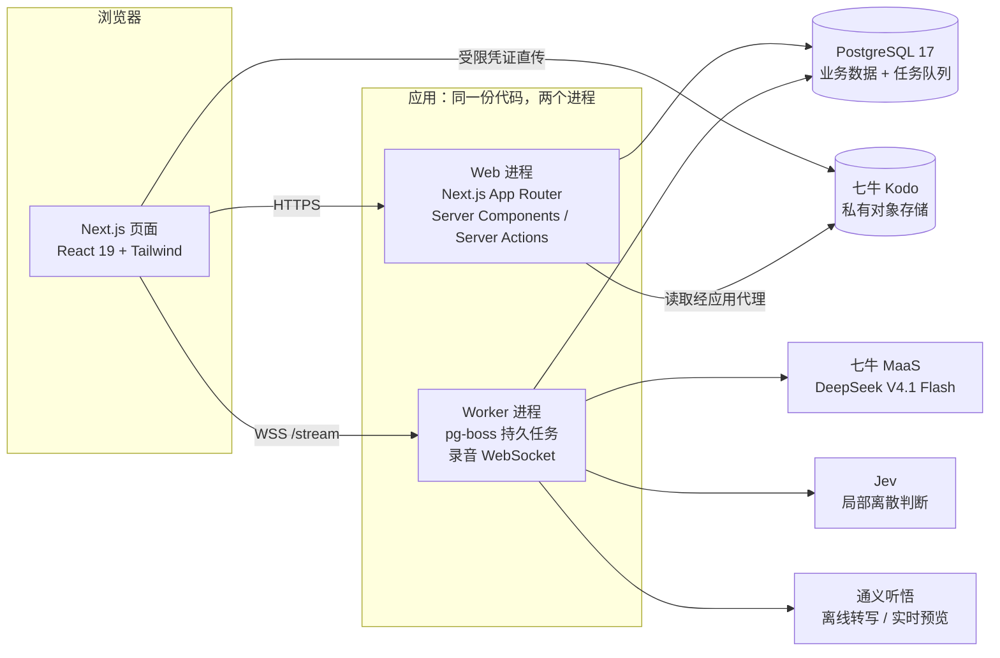
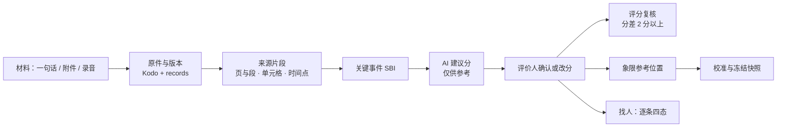
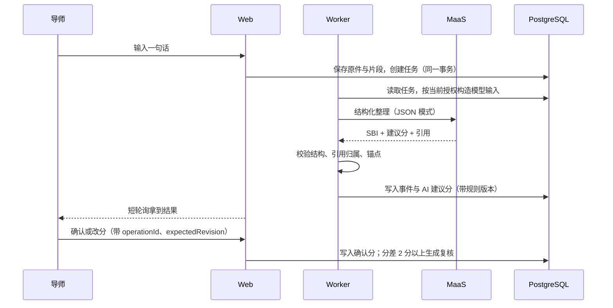
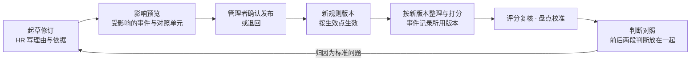
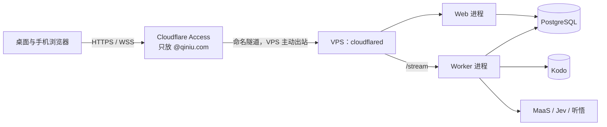

# Niu-Talent 架构设计

| 项目 | 内容 |
| --- | --- |
| 适用版本 | `main` 提交 `3f64569`（2026-11-01）。第 12 节的实现状态以这个提交为准，之后合入的 PR 需同步更新该节 |
| 本文回答 | 三个核心价值点由哪些模块支撑（1.1）；原型怎么组织（1.2）；正式工程由哪些部分组成、每个模块负责什么、模块之间怎么协作（第 2～11 节）；现在做到哪一步、团队如何分工（第 12～13 节） |
| 决策记录 | 选型的取舍过程、已确认决定 U-1～U-21 和多轮审查记录见 [产品架构分期提案](proposals/2026-10-25-y-architecture-phases.md)；本文只写结论，两者冲突时以已确认决定为准 |
| 可视化 | [产品架构与分期规划](../prototype/architecture.html)（原型评审站页面） |

## 1. 系统概览

Niu-Talent 是七牛云内部的 AI 原生人才工作台，核心价值是三件事：

1. **人才搜索**：管理者用一句话描述项目要的人，AI 起草需求卡，系统拿已确认的证据逐条对照候选人，只给「支持 / 不支持 / 资料不足 / 证据冲突」四种状态，每条都能回到来源，不出总分。
2. **人才档案**：一句话、附件、录音经 AI 整理成关键事件（SBI：情境、行为、结果）和建议分，评价人确认后进入档案；档案里每个分数都带锚点、原文引用、评分人和规则版本，按视角投影可见内容。
3. **人才评价体系的建立与迭代**：维度与锚点、象限落位、值得关注等六类规则集中管理、按版本生效；评分复核与盘点校准保证执行；判断对照用后一阶段的结果检验前一阶段的判断，归因后起草规则修订，经确认按生效点生效，不改写历史。

三者共用一条证据链，形成闭环：评价体系规定怎么判断 → 判断沉淀为档案 → 档案支撑搜索 → 任用与盘点的结果回到判断对照 → 修订评价体系。AI 只产生可追溯的建议，正式结论由有权限的人确认。

**用户**：管理者（公司层，看人、找人、确认规则与方案）、HR（整理档案、评分复核、校准）、导师（记录所带学员、确认本人评分），外加只管配置、看不到人才数据的系统管理员。

**交付形态**：

| 部分 | 位置 | 作用 |
| --- | --- | --- |
| 高保真原型 Y | `prototype/y/` | 完整演示全部页面与交互；独立 HTML，AI 行为用预置结果按真实节奏流式输出 |
| 正式工程 | 仓库根目录 `src/` 等 | 把原型逐页做成真实功能：真实数据库、服务端权限、真实 AI 与语音服务；界面 1:1 还原原型 Y |
| 评审站 | `review-site/` | 把原型发布给 `@qiniu.com` 评审并支持划线评论，只服务评审 |

### 1.1 价值点与支撑模块

| 价值点 | 关键能力 | 原型页面（`prototype/y/app/`） | 原型逻辑 | 正式工程的支撑 | 工程链路 |
| --- | --- | --- | --- | --- | --- |
| 人才搜索 | 一句话建需求卡；必须 / 加分要求；逐条四态并附来源；按必须项支持数排列；目标角色模板；标签检索 | `staffing`、`people`、`projects` / `project`、`tags`、`rules?r=tpl` | `pages/staffing.js`（预置场景、候选排序、方案槽位）、`pages/people.js` | staffing 领域（项目、成员、需求卡与四态）；talent 读取；Jev 适配器；`people.ts`、`projects.ts`、`staffing.ts` 契约 | P2 |
| 人才档案 | 证据链；SBI 整理与建议分；确认或改分；五种内容性质分开；人名与说话人核对；按视角投影 | `person`、`record`、`recording`、`inbox`，手机 `quick`、`record`、`inbox` | `parse.js`（整理）、`pages/person.js`、`pages/record.js`、`pages/recording.js`；引用与事件卡在 `ui.js` | records 领域（原件、版本、片段、事件、陈述）；talent 领域（建议分与确认分）；authz 的按用途投影；MaaS、听悟、Kodo 适配器；`person.ts`、`sources.ts`、`workbench.ts` 契约 | P0、P1、P3、P4、P5 |
| 人才评价体系 | 六类规则与版本；修订、影响预览、确认发布、按生效点生效；评分复核；盘点校准与冻结；判断对照与归因；节点复盘 | `rules`、`judge`、`queue`、`reviews` / `review`、`calibrate`、`plan`、`landing-review`、`actions` | `pages/rules.js`、`pages/judge.js`、`pages/queue.js`；参考位置、变化与档案版本在 `store.js` 中按规则实时计算 | evaluation-system 领域（维度、锚点、规则版本）；事件保存时记录规则版本，锚点用复合外键防止跨版本引用；talent 领域的评分复核 | 规则数据底座已建；修订流程与判断对照本次留在原型 |

### 1.2 原型的结构

本次比赛交付的是原型 Y。它不依赖构建工具和后端，任何静态文件服务器都能托管；结构如下：

```text
prototype/
├─ index.html            评审导览：按角色和走查路线列出入口
├─ architecture.html     产品架构与分期规划（可视化）
└─ y/
   ├─ assets/            设计变量、组件样式、小犇 IP 形象、演示头像
   ├─ design-system.html 「光与墨」设计系统：规范与组件样张
   ├─ app/               桌面版 21 个页面（*.html + app.css）
   │  └─ js/
   │     ├─ core.js      公共工具：全局 NT 命名空间、流式输出、恢复现场
   │     ├─ data.js      演示种子：人员、项目、评分锚点、角色预设
   │     ├─ data-xe6.js  XEngineer 第六期演示数据（生成文件）
   │     ├─ store.js     演示状态与业务规则：权限过滤、象限参考位置、变化、档案版本
   │     ├─ parse.js     脚本化的「整理」：从原话里找人、拆 SBI、给建议分
   │     ├─ ui.js        共用界面片段：引用角标、事件卡、评分行、修订历史、附件等
   │     ├─ shell.js     桌面外壳：侧栏导航、顶栏搜索、视角切换、录音条
   │     └─ pages/       每个页面一个脚本
   └─ m/                 导师手机版 8 个页面，复用 app/js 的数据、状态和界面片段
```

| 关注点 | 原型的做法 |
| --- | --- |
| 数据 | 化名的 XEngineer 第六期数据作为只读种子；`store.js` 在浏览器 `localStorage` 里维护可变副本，每位评审者的操作互不影响，可一键重置 |
| 业务规则 | 象限参考位置、变化提醒、档案版本都由 `store.js` 从已确认的事件分实时算出，确认或改分后页面随之变化；规则与需求定稿一一对应 |
| 权限 | `?as=` 参数或顶栏切换视角，`store.js` 按「先过滤再呈现」模拟服务端：导师看不到象限，系统管理员打开业务页面被整页拦下，管理者看不到按评价人的数字 |
| AI 行为 | `parse.js` 与预置结果模拟整理、建议分、四态判断、转写和复盘草拟，经 `NT.stream` 按真实节奏流式输出；界面上 AI 内容与人工结论分开标识 |
| 异常与边界状态 | 用 URL 参数直接演示：录音的网络中断（`net=drop`）、刷新恢复（`step=resume`）、处理中（`step=processing`）、麦克风未授权（`mic=deny`） |
| 设计系统 | 设计变量（`niu-tokens.css`）和组件样式（`niu-components.css`）集中在 `y/assets/`，设计系统页、桌面版和手机版共用；正式工程从这里原样移植 |
| 评审 | `review-site/` 用 Cloudflare Worker 把 `prototype/` 原样发布给 `@qiniu.com`，每页挂划线评论（D1 存储） |

正式工程以原型 Y 的固定提交 `2e51b50` 为视觉基线 1:1 还原，下文第 2 节起描述正式工程的架构。

### 1.3 正式工程的组成



## 2. 技术栈与选型

| 层 | 选型 | 理由 |
| --- | --- | --- |
| 运行时 | Node.js 24 LTS，pnpm 单 package | Web 与 Worker 同一份代码、同一套类型；单 package 降低并行开发的协调成本 |
| Web 框架 | Next.js 16 App Router，React 19，TypeScript 严格模式 | Server Components 直接在服务端按权限读取数据，Server Actions 承接写操作，减少一层 API 胶水代码 |
| 样式与组件 | Tailwind CSS 4，Radix 无样式原语，Motion | 设计变量和组件样式从原型 Y 原样移植；只借用 Radix 的可访问性行为，不采用组件库的默认外观 |
| 数据库 | PostgreSQL 17 + Drizzle ORM | 证据链、评分确认、规则版本都需要事务、外键与唯一约束；Drizzle 的 schema 即类型 |
| 持久任务 | pg-boss（复用 PostgreSQL） | 转写、整理、判断等长任务需要可恢复、可重试；复用同一个数据库，暂不引入 Redis |
| 认证 | Better Auth，关闭公开注册 | 四个预置演示账号；会话存在 PostgreSQL |
| 入口保护 | Cloudflare Access + 应用内令牌验签 | 演示环境只放 `@qiniu.com`；应用对每个请求和 WebSocket 握手验签，源站地址泄露也绕不过 |
| 对象存储 | 七牛 Kodo 私有空间 | 录音、附件原件不公开；浏览器凭受限凭证直传，读取经应用代理 |
| AI | 七牛 MaaS（`deepseek/deepseek-v4.1-flash`）、Jev（`typesafe/jev-1.14`）、通义听悟 | MaaS 做结构化整理（JSON 模式 + 服务端校验）；Jev 做逐条四态这类局部判断；听悟以离线稿为准、实时稿只做预览 |
| 校验 | Zod 4 | 前后端契约、环境变量、外部服务响应统一用严格 schema 校验 |
| 测试 | Vitest、Playwright | 单元、真实 PostgreSQL 集成、浏览器流程、原型对工程的截图比较 |

## 3. 运行时架构

- **Web 进程**（`pnpm start`）：页面渲染、Server Actions、`/api/auth/*`（Better Auth）、`/api/jobs/{jobId}`（任务进度短轮询）。只监听本机地址。
- **Worker 进程**（`pnpm start:worker`）：启动 pg-boss 执行持久任务；在本机 3001 端口提供录音 WebSocket，握手时校验 Access 令牌、同源 Origin 和 Better Auth 会话。Worker 与路由层互不引入代码。
- **PostgreSQL**：业务表按领域分前缀（`directory_*`、`records_*`、`talent_*` 等）；任务快照 `job_*` 与 pg-boss 队列在同一个库里，业务写入和任务状态可以在一个事务里提交。
- **外部服务**：适配器只在服务端组合入口显式创建，构造时不发请求、不读 `.env`；凭据只来自进程环境。

演示环境的部署见第 11 节。

## 4. 分层与目录

```text
src/
├─ app/                 路由与布局：只调用 queries / actions / contracts，组装界面
├─ features/<区域>/      按页面区域组织的界面组件与客户端状态
├─ components/ui|brand  设计系统基础组件、小犇 IP
├─ styles/              从原型 Y 移植的设计变量与组件样式
├─ contracts/           前后端契约：读取结果与动作输入（Zod）
├─ lib/                 前后端共用的无副作用工具（时钟、任务订阅）
├─ server/
│  ├─ queries/ actions/ 页面读取与 Server Actions 入口，按「用途」授权
│  ├─ usecases/         跨领域命令，一个事务完成
│  ├─ modules/<领域>/    业务领域，各自只写自己的表
│  ├─ auth/ authz/ access/ platform/   会话、授权核心、Access 验签、审计
│  ├─ integrations/     MaaS、Jev、Kodo、听悟适配器
│  ├─ jobs/             持久任务快照、控制与订阅
│  └─ db/               连接、迁移、演示数据导入
└─ worker/              常驻进程入口与 WebSocket 握手
```

依赖方向自上而下：界面 → 入口（queries / actions）→ 用例 → 领域 → 数据库。`pnpm lint` 里的 `scripts/check-boundaries.ts` 会自动拦截越界引入，主要规则：

- 界面层（`app/`、`features/`、`components/`）不得引入 `src/server/`，唯一例外是 `/api/auth` 路由引入认证适配器。
- 领域之间只经对方的 `index.ts` 入口调用，不直接读写别的领域的表。
- 外部服务适配器不得引入业务模块；送给模型的内容只在服务端按授权过滤后构造。
- Worker 与 `app/` 互不引入。

## 5. 模块规格

### 5.1 业务领域

七个领域按「谁有权改变哪一份事实、一次改变必须保证什么」划分，共用一个仓库和一个 PostgreSQL，是模块而不是服务。

| 领域 | 职责（唯一维护的事实） | 数据表 | 对外入口 | 状态 |
| --- | --- | --- | --- | --- |
| directory 人员、组织与授权 | 人员与组织、任职、账号绑定、角色预设与范围授权 | `directory_people`、`directory_organizations`、`directory_employments`、`directory_account_bindings`、`directory_grants` | `readDirectory(db, accountId)` | 已实现 |
| records 材料与记录 | 原件与版本、来源片段（页与段 / 单元格 / 时间点）、关键事件、参与人、本人自述与管理观察、历史评价 | `records_originals`、`records_original_versions`、`records_fragments`、`records_events`、`records_event_participants`、`records_event_sources`、`records_statements`、`records_historical_evaluations`、`records_historical_participants`、`records_import_snapshots` | 表定义与 `SourceLocation` 类型 | 模型已实现；整理、附件、上传用例在 PR 中 |
| talent 人才评价与盘点 | AI 建议分、人工确认分、评分复核；后续加盘点批次、象限、冻结快照、档案版本 | `talent_ai_suggestions`、`talent_confirmations`、`talent_score_reviews` | 表定义；人才读取经 `queries/person.ts`、`people.ts` | 模型与读取已实现；确认改分在 PR 中 |
| staffing 项目用人 | 项目与课题、成员历史、需求卡版本、候选逐条四态、找人方案 | `staffing_projects`、`staffing_members`、`staffing_member_logs`、`staffing_create_requests` | `readStaffing`、`insertProject`、`readCreateRequest` | 项目与课题已实现；需求卡与四态在 PR 中 |
| programs 人才项目 | 人才项目与期次、学员名单、导师与学员关系 | `programs_cohorts`、`programs_enrollments`、`programs_assignments` | `readProgramScopes(db)` | 已实现（授权所需部分） |
| evaluation-system 人才评价规则 | 维度与行为锚点、规则版本；后续加修订、预览、发布与判断对照 | `evaluation_dimensions`、`evaluation_rule_versions`、`evaluation_anchors` | 表定义 | 锚点与版本已实现；修订流程留在原型 |
| engagement 关注与行动 | 值得关注、我的关注、推荐方向、改进事项 | — | — | 本次比赛留在原型演示 |

关键约束（数据库层面保证）：

- 引用由 `fragmentId + originalVersionId + location` 三者确定，空引用被约束拒绝；不存「看起来像引用的文字」。
- 一个可评分事件只属于一个人；多人事件的其他参与人单独记录，不会把团队分复制给个人。
- 维度分只能是 1–5 的整数且必须带锚点；「资料不足 / 未体现」数值和锚点为空，不等于 0。锚点的 ID、维度、版本由复合外键一起匹配，旧版锚点拼不到新版事件上。
- 有效人工确认的唯一键是「事件 + 维度 + 评价人」；AI 建议分与确认分分表存储。
- 原始事实、本人自述、管理观察、AI 推断、人工结论用 `records_statements.kind` 分开；AI 内容必须带模型版本，不能署人工作者。

### 5.2 平台能力

| 模块 | 职责 | 要点 |
| --- | --- | --- |
| `server/auth` | 登录与会话 | Better Auth，关闭注册；四个预置账号 `ceo@`、`hrbp@`、`mentor@`、`admin@qtalent.test`，密码只从 `DEMO_PASSWORD` 读取 |
| `server/authz` | 授权核心 | 判断「当前账号 × 动作 × 范围 × 用途」；每份完整授权单独判断，不把一个身份的动作和另一个身份的范围拼成更大的权限。人才数据按用途（列表、速览、档案、工作台、读来源、模型输入）逐条投影可见字段 |
| `server/access` | 入口验签 | 对 `Cf-Access-Jwt-Assertion` 做 RS256 验签，核对签发方、AUD、过期时间；demo / production 必须开启 |
| `platform/audit` | 审计 | `audit_events` 目前记录登录与新建项目；授权变更与敏感读取的审计在赛后试点上线真实资料前补齐 |
| `server/jobs` | 持久任务 | 任务快照与操作账本 `job_snapshots`、`job_operations`；状态机见第 9 节；`/api/jobs/{jobId}` 短轮询读取已授权的快照 |
| `server/db` | 连接、迁移、导入 | 迁移显式执行，启动不自动迁移；演示数据从原型 Y 的固定提交 `2e51b50` 导入，逐文件校验摘要，幂等 |

### 5.3 外部服务适配器

| 适配器 | 职责 | 失败处理 | 状态 |
| --- | --- | --- | --- |
| `integrations/maas` | 结构化生成：输入已授权、最小化的文字证据和业务 Zod schema，输出通过校验的 JSON | 超时、非 JSON、截断、模型不符、结构不符全部拒绝；结果未知时不冒充成功 | 真实客户端已合入 |
| `integrations/jev` | 找人逐条四态、标签判定等离散判断 | 出错或超时只改处理进度为「待人工判断」，结论留空，不记为「资料不足」；输出按白名单投影，confidence 和原始响应不出适配器 | 真实客户端已合入 |
| `integrations/kodo` | 私有对象读写、受限直传凭证、v2 分片续传、给听悟的限时来源 | 写入以 stat 核对完整对象为准；响应丢失先查再报；分片 checkpoint 只在服务端 | 真实客户端已合入 |
| `integrations/tingwu` | 实时推流预览（`realtime/`）与离线转写 | 实时稿只做预览；暂停只停止当前识别周期；结束结果未知时不重建记录掩盖 | 实时适配器与离线转写客户端已合入 |

### 5.4 前后端契约

`src/contracts/` 用 Zod 定义每个页面区域的读取结果与动作输入，后端起草、前端评审，先合契约再并行做读取、动作和界面。

| 契约 | 内容 |
| --- | --- |
| `shell.ts` | 外壳导航项与当前账号信息 |
| `projects.ts` | 项目列表、新建项目输入与结果 |
| `workbench.ts` | 按角色区分的工作台读取结果 |
| `people.ts` | 人才列表与速览（管理者、导师两种视图） |
| `person.ts` | 人员档案：引用、AI 推断、管理观察、维度分、参考位置；每块区分「未接入 / 空 / 资料不足 / 未知」 |
| `sources.ts` | 来源读取：位置类型与原件 / 原型基线两类来源 |
| `jobs.ts` | 任务状态、进度、错误码与控制命令 |

另有 `record.ts`（记一件事）、`review-queue.ts`（评分复核）、`staffing.ts`（找人需求与逐条判断）、`media.ts`（上传录音与附件），对应的实现 PR 见第 12 节。

### 5.5 前端

- **路由**：`(auth)/login` 登录；`(desk)/projects` 项目与课题；`/dev/design-system/*` 设计系统样张（生产环境不可访问）。其他页面按任务卡逐页从原型还原。
- **页面区域**：`features/auth`、`features/shell`（外壳、账号菜单、命令菜单、无权限页）、`features/projects`。
- **设计系统**：`components/ui` 已有通用组件、人才与 AI 展示组件、上传与长任务组件、处理进度组件；每个组件都有样张页，与原型截图逐一比较。

## 6. 关键数据流

### 6.1 证据链



三条主线都挂在这条链上：找人读已确认的证据，重点跟踪读已确认的事件，盘点读确认分和冻结快照。

### 6.2 人才档案：记一件事（P1）

下图是 P1 契约（#129，已合入）与实现 PR（#185、#162）的设计流程，实现合入后以实际代码为准。



### 6.3 人才搜索：找人（P2）

需求卡逐条匹配已确认、能回到来源的证据 → Jev 判断每条的四态 → 每条附来源。Jev 失败时这一条显示「待人工判断」，人工判断后仍选四态之一并署名。

### 6.4 人才档案：录音（P3 离线、P5 实时）

音频先完整存入 Kodo，离线转写稿是事件提取的唯一来源。实时推流经 Worker 的 WebSocket 转给听悟，只做预览；结束后以离线稿为准。说话人编号不自动绑定员工，需要人工核对。

### 6.5 人才评价体系：建立与迭代



- **版本即事实**：规则内容和修订状态（草稿、待确认、已排期、生效中、已替代）固定在同一个不可变版本里；事件保存时记录当时生效的锚点版本，之后不静默重算。入营选拔标准（`xe_selection`）例外：确认发布后即对之后新建的期次生效，没有「已排期」；期次建立时绑定所用版本，按期次读取。
- **原子发布**：确认发布在一个 PostgreSQL 事务里完成：锁定该类规则、检查进行中的盘点、保存新版本、为不兼容修订创建复核任务、写审计；任一步失败整笔回滚。「发起盘点」拿同一把锁，避免盘点和规则用了不同口径。
- **判断对照只作用于评价体系**：它所在的领域没有写评分、象限和档案的入口；后一阶段的结果不当作正确答案，样本不足时只显示「样本不足」。
- **工程现状**：维度、锚点、规则版本和「事件记录规则版本」的约束已在数据库中实现（5.1）；标准迭代与期次授权契约已冻结合入（BOW-917，#258）。修订流程、原子发布和判断对照正在工程里实现，均在评审中：按类别和时间读取生效版本（BOW-922，#265）、入营选拔标准的原子发布与配对撤销（BOW-918，#269）、原量表对照（BOW-919，#270）、授权归因与修订提案（BOW-921，#273）。设计见 [架构分期提案](proposals/2026-10-25-y-architecture-phases.md) 4.2。

## 7. 权限模型

角色只是一组动作和一种范围的预设，授权在服务端判断；原型顶栏的视角切换只是演示手段。

| 预设 | 主要动作 | 范围 |
| --- | --- | --- |
| 管理者 | 看人与档案、找人、确认规则修订与找人方案 | 全公司 |
| HR | 记录、整理档案、评分复核、象限校准、留用与落位方案 | 负责的期次及其学员 |
| 导师 | 记录所带学员、确认本人评分；看不到象限 | 所带学员 |
| 系统管理员 | 账号、角色与范围、集成配置、审计 | 系统配置；看不到人才数据 |

执行顺序：先按权限过滤证据，再交给页面或模型。同一份数据按用途投影不同字段，例如导师看不到象限，模型输入只含本次需要且已授权的片段。

## 8. 产品不变量的落点

| 不变量 | 落点 |
| --- | --- |
| 没有总分、排名、百分比、雷达图 | 契约里没有这类字段；读取不提供按分数排序 |
| AI 建议分未经确认不计入档案和象限 | 建议分与确认分分表；象限、档案、找人只读确认分 |
| 每个分数都有锚点、引用、评分人、规则版本 | 数据库约束 + 复合外键（5.1） |
| 「资料不足」不是反向证据 | 数值和锚点为空，不等于 0；契约单独区分「资料不足」与「未知」 |
| 找人只用四种状态 | 结论只有四态，处理进度另列；Jev 失败不写结论 |
| 原始事实、自述、观察、AI 推断、人工结论分开 | `records_statements.kind`；AI 内容必须带模型版本 |
| 先按权限过滤，再交给模型 | `authz` 的 `model-input` 用途投影；适配器不读数据库、不做授权 |
| 规则修订不改写历史 | 事件保存时记录规则版本；不静默重算 |
| Jev confidence 不当能力分 | Jev 适配器按白名单投影输出，confidence 不出适配器 |

## 9. 可靠性与一致性

- **确认只生效一次**：同一请求重放靠 `operationId` 返回原结果；不同页面确认同一份建议靠业务唯一键拦住；旧页面提交带 `expectedRevision`，版本不符返回冲突并保留输入。
- **任务状态机**：`queued → running → partial → completed`，也可能进入 `awaiting_manual`（需人工后显式恢复）或 `failed`（显式重试，尝试次数加一）。取消先持久记录请求，Worker 安全停止后才写 `cancelled`，不删除来源和已有事实。
- **外部结果未知**：超时或响应丢失时报告「未知」，不当成功也不盲目重试；Kodo 先查对象再决定。
- **跨领域事务**：跨领域的命令放在 `usecases/`，一个 PostgreSQL 事务完成，任一步失败整笔回滚。

## 10. 质量保障

| 层次 | 工具 | 内容 |
| --- | --- | --- |
| 静态检查 | Prettier、ESLint、边界检查、`tsc` 严格模式 | `pnpm lint` 同时运行引入边界检查 |
| 单元测试 | Vitest | 62 个测试文件，不连数据库 |
| 集成测试 | Vitest + 真实 PostgreSQL | 每次创建随机 `_test` 数据库；单元 + 集成统一统计覆盖率，行与分支各 ≥ 85% |
| 浏览器流程 | Playwright | 四个账号的登录、权限、新建与重复提交 |
| 视觉还原 | Playwright 截图比较 | 同一固定基线的原型页与工程页逐一比较，数据先一致再比较画面 |
| CI | GitHub Actions `foundation` | 每个 PR 运行 `pnpm check`、浏览器流程与视觉比较 |

工程基础的实际验证记录与未验证边界见 [docs/evidence/foundation](evidence/foundation/README.md)。

## 11. 部署

演示环境的目标形态：



- 一台 VPS 同时运行 Web 和 Worker 两个进程，都只监听本机地址，由 systemd 守护（样例在 `deploy/`）；防火墙不开放 80 / 443。
- Cloudflare 命名隧道按路径把 `/stream` 转给 Worker、其余转给 Web；Access 只放 `@qiniu.com`，应用自己再用预置账号登录。
- 迁移与演示数据导入在维护步骤里显式执行，启动不自动迁移。
- 不选 Vercel：实时推流需要长时间的 WebSocket 和常驻进程，Vercel 上只能用实验接口且函数有时长上限。

**当前状态**：正在按 U-5 方案为决赛部署上面的正式工程演示环境（DigitalOcean 新加坡机器 + Cloudflare 命名隧道和 Access + Supabase），只部署已合入 `main` 的提交，进度与部署记录见 [#25](https://github.com/bowenQT/QTalent/issues/25)，验收按 [架构分期提案](proposals/2026-10-25-y-architecture-phases.md) 6.5 执行；发布与恢复脚本（BOW-833，#255）在评审中。原型评审站（`review-site/`，Cloudflare Worker 发布，`@qiniu.com` 登录）继续只服务原型评审。

## 12. 实现状态

截至 `main` `3f64569`（2026-11-01）。「原型」指 `prototype/y/` 中可完整演示；「工程已合入」只列已合入 `main` 的 PR；「评审中」是未合入的 PR，多数还在等依赖或正式迁移。

| 链路 | 原型 | 工程已合入 | 评审中的 PR |
| --- | --- | --- | --- |
| P0 骨架：登录、范围过滤、演示数据、工作台与档案读真实库 | 完整 | 工程基础与项目页（#67）、授权扩展（#80、#170）、证据模型与演示数据导入（#83、#158）、P0 契约（#77）、任务进度（#94）、外壳路由（#200）、人才与来源读取（#131、#216）、引用角标（#190）、设计系统组件（#102、#113、#120、#187）、连接池与 worker 稳定性修复（#167、#168） | 工作台读取（#171）、契约补齐（#202）、受限来源读取（#284）、评价节点与重新分派（#262）、部分确认与待核对契约（#254）、可信入口与会话核验（#271）、工作台页面（#256）、人员档案页面（#252）、演示材料与回归（#251、#261） |
| P1 记一件事：AI 整理 SBI 与建议分 → 确认 → 复核 | 完整 | MaaS 客户端（#78）、契约（#129） | 批次草稿与来源校验（#185）、确认改分与撤销（#162、#278）、Modelink 结构化输出（#253）、记一件事页面（#208）、HR 评分复核（#268）、管理观察（#274）、HR 节点结论（#275） |
| P2 找人：需求卡 → 逐条四态 → 来源 | 完整 | Jev 客户端（#91、#105）、契约（#130） | 需求卡（#161）、逐条四态（#188）、找人页面（#266） |
| P3 离线转写：上传 → Kodo → 听悟 → 说话人绑定 | 完整 | Kodo 客户端（#82、#164、#169）、上传契约（#112）、听悟离线转写客户端（#199） | 上传校验与原件代理（#186）、Kodo 上限对齐（#263）、原始 MP4 转写（#264）、归档录音离线处理（#276）、人工说话人绑定（#279） |
| P5 实时推流：浏览器 → WebSocket → 听悟预览 | 完整（桌面） | 听悟实时适配器（#92） | 浏览器推流与归档编排未开始 |
| P4 文本附件：TXT / DOCX / 文字型 PDF → 段落 | 完整 | 上传契约（#112，与 P3 共用） | 附件解析（#189）、面评解析与文本定位（#257）、Office 原文提取（#272）、面评导入决策（#277）、图片裁剪（#281） |
| 评价体系：规则版本、修订发布、判断对照 | 完整 | 标准迭代与期次授权契约（#258） | 按类别和时间读取生效版本（#265）、入营选拔标准原子发布（#269）、原量表对照（#270）、授权归因与修订提案（#273）、第三幕原表（#267） |
| 入口：企业微信与 MCP | 不涉及 | — | 企业微信协议与回执（#282）、MCP 三工具（#280） |

尚无工程 PR、仍只在原型演示：盘点冻结与留用落位、值得关注。

## 13. 分工

### 13.1 团队成员

bowenQT、Joanrecruiting、yiyih7077-cell。各自的提交与审查记录见仓库的提交历史和 Pull Request。

### 13.2 模块与任务卡的归属

目录按「谁来改」划分，让前端、后端、集成的任务卡各自落在不同目录里，可以并行开发而少冲突：

| 目录 | 任务卡类别 |
| --- | --- |
| `src/app/`、`src/features/` | 前端页面 |
| `src/components/ui/`、`brand/`、`src/styles/` | 设计系统 |
| `src/contracts/` | 后端起草，前端评审 |
| `src/server/` 下的 `queries/`、`actions/`、`usecases/`、`modules/`、`auth/`、`authz/`、`platform/` | 后端 |
| `src/server/integrations/`、`jobs/`、`src/worker/` | 集成 |
| `tests/`、`deploy/` | 测试验收、基础设施 |

### 13.3 协作方式

- 需求与任务卡在 Linear 拆分（BOW-8xx / BOW-9xx），每张卡写明可改的目录与文件。
- 多个编码 Agent 在各自的 worktree 中并行实现任务卡：Claude Code 负责前端、原型同步与界面还原；Codex 负责后端、集成与迁移，由 Dot 编排派卡与收尾。常驻职责 X1 管共享文件、迁移顺序和 `ready-to-merge` 标签，X2 管部署与环境。Agent 的工作约束统一写在 [AGENTS.md](../AGENTS.md)。
- 每个任务一个分支、一个 PR，由另一种工具交叉审查；满足合并门禁后，由所有者授权的 Claude Code 编排会话以所有者账号 Squash 合入 `main`。带数据库迁移的 PR 按迁移顺序一次只合一个。
- 分工、认领、审查与合并门禁见 [CONTRIBUTING.md](../CONTRIBUTING.md#并行开发合并与审查)，工程细则见 [工程规范](engineering.md)。

## 14. 已知边界

- 认证只用四个预置账号，不接公司 SSO；北森同步和系统管理只在原型里给演示视角。
- 手机端的锁屏、切页、长录音没有在真机验证；实时推流只验收桌面浏览器。
- 演示数据是化名的 XEngineer 第六期数据，会发给 MaaS、听悟、Jev（含境外端点）；接真实资料前需要重新评估数据外发。
- 外部服务的真实调用验收以各 PR 记录为准；适配器的自动测试替换了网络边界，不代表供应商联调结果。

## 15. 相关文档

- [产品架构分期提案](proposals/2026-10-25-y-architecture-phases.md)：决策过程、长期与中期规划
- [需求定稿 · 版本 Y](requirements/需求定稿-版本Y.md)、[需求定稿 v1.6](requirements/需求定稿-v1.6.md)
- [工程规范](engineering.md)、[原型路由与模块映射](reference-route-map.md)、[切片权限用例](foundation-permissions.md)
- [环境变量与部署样例](../deploy/README.md)
- 各适配器与模块的 README：`src/server/integrations/*/README.md`、`src/server/jobs/README.md`、`src/server/modules/records/README.md`、`src/server/db/seed/README.md`
