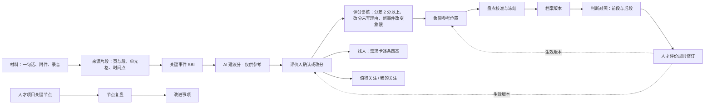
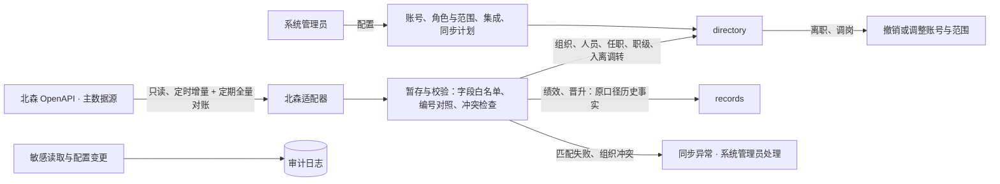
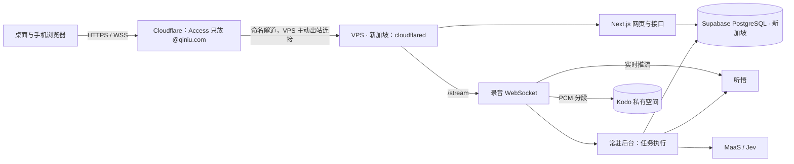

# 提案：以版本 Y 为主线的产品架构分期（长期 / 中期 / 本次比赛）

| 项目 | 内容 |
| --- | --- |
| 状态 | Draft（整体）。第 2 节的 U-1～U-21 为用户 2026-10-25 明确决定，其中 4.2 的七域划分为 Accepted（U-7）；其余为建议，待确认 |
| 版本 | v3，2026-10-25，Asia/Shanghai。v1 之后补入北森同步、系统管理与审计、按阶段的功能模块规划，演示环境定为 VPS；v3 把比赛工程改为正式工程的起点（U-18～U-21），新增 4.7 工程目录与分工 |
| 可视化 | [产品架构与分期规划](../../prototype/architecture.html)（评审站页面，内容与本文一致，以本文为准） |
| 负责人 / 决定者 | 本文起草：Claude；决定者：用户 |
| 关联 issue / PR | [bowenQT/QTalent#14](https://github.com/bowenQT/QTalent/pull/14) |
| 需求 / 设计依据 | [需求定稿 · 版本 Y](../requirements/需求定稿-版本Y.md)（Y-1.1）；[需求定稿 v1.6](../requirements/需求定稿-v1.6.md) 第 3.35 节；[AGENTS.md](../../AGENTS.md) 的产品不变量与阶段门禁；原型 `prototype/y/`（main `2e51b50`，即 U-19 的定稿基线） |
| 架构输入 | 《正式站点架构与技术方案》v21（整体 Draft，§7.1、§7.4 部分 Accepted）。该文与其实验记录目前只在 Codex 研究工作区 `~/.codex/worktrees/qtalent-architecture-research/QTalent/docs/`，未进入本仓库；下文写作「v21 §x」 |
| 替代关系 | 不替代 v21。本文只回答「Y 成为主线后，v21 哪些要改，三个阶段各做到哪」；v21 已 Accepted 的口径原样沿用 |
| 讨论与审查 | Codex（`gpt-6-astra`，推理强度 xhigh）独立讨论、对抗审查、修订复核、v2 新增部分审查、工程基础任务说明审查共五轮，处理记录见第 9 节 |

## 1. 结论

1. **主线**：长期以版本 Y 为主线（U-1）。三种角色是「权限预设」，不是写死的身份；以后把管理者细分成 CEO 和部门负责人、加回员工本人，只新增预设和范围类型，人员、事件、评分等业务数据不用改；前提是授权按「名单与有效期 + 多重身份取并集」执行（3.2）。长期还要加入员工本人入口（U-14）。
2. **骨架不变**：三个阶段共用一条证据链和 AGENTS.md 的产品不变量（3.1、3.3）。比赛做的东西可以简化实现，不能改这条链的语义。
3. **七个业务领域（已确认，U-7）**：在 v21 六域基础上新增「人才项目」域，承接期次、关键节点、节奏、对人复盘场次和节点复盘；把「判断复盘」扩为「人才评价规则」域，统一管需要管理者确认的四类规则的修订与生效，并保留判断对照（4.2）。
4. **长期形态**：Next.js 模块化单体 + PostgreSQL + 私有对象存储 + 常驻 Node 后台，沿用 v21 首选，部署在国内可运行常驻进程的环境（4.6）。
5. **平台能力补齐**：北森是组织、人员与人事数据的主数据源，只读同步组织与任职、入离调转、绩效、晋升与职级；绩效和晋升只作历史事实（U-8、U-9）。单设系统管理员，管账号、角色与范围、同步、集成配置和审计，默认看不到人才数据（U-10）。这些不新增业务领域，事实仍归原领域（4.3）。授权变更要防止自行扩权：学员名单增补和业务角色授予都要管理者确认（U-16、U-17）。功能模块按阶段的规划见 4.4 与[可视化页](../../prototype/architecture.html)。
6. **中期**：赛后用一个真实人才项目试点 Y 的三种角色加系统管理员，由 Codex 在第 3 阶段建立正式工程。门槛分两道：正式工程开工前定方案；真实资料上线前，北森组织与任职同步、权限与撤权、访问审计、并发确认、备份恢复、实际使用的录音路径必须先验收。比赛的验证代码不默认转正（第 5 节）。
7. **短期（本次比赛）**：按正式工程标准在根目录建工程，界面 1:1 还原原型 Y（U-18、U-19），守住 6.2 的八条合同。六条链路全部必做（U-4），顺序：骨架与权限 → 记一件事 → 找人（含 Jev）→ 离线转写 → 实时推流 → 文本附件。实时推流建在完整归档和离线稿之上，实时稿只做预览（6.3）。北森同步和系统管理在原型里给演示视角，工程用种子数据。
8. **演示环境（U-5）**：DigitalOcean 新加坡一台 VPS 运行 Next.js、常驻后台和录音 WebSocket，经 Cloudflare 命名隧道对外、Access 只放 `@qiniu.com`，VPS 不开放网页端口，应用校验 Access 令牌；Supabase 做 PostgreSQL。Vercel 方案里，实时推流压在公测 WebSocket 和实验接口上，Daemons 也不接入站连接，所以不选（6.5）。

## 2. 问题、已确认决定与约束

v21 是按版本 X（五种角色、需求 v1.2～v1.6）写的。Y 成为主线后，需要一份把产品终局、赛后试点和比赛切片串起来的架构：比赛做的东西不偏离终局，也不被终局的完整度拖垮。

**用户本轮决定（2026-10-25）**

| 编号 | 决定 | 适用范围 |
| --- | --- | --- |
| U-1 | 长期以 Y 为主线；管理者以后可以细分为 CEO 和部门负责人 | 第 3、4 节 |
| U-2 | 比赛的工程部分作为可丢弃技术验证（已由 U-18 取代） | 第 6 节 |
| U-3 | XEngineer 第六期化名演示数据可以发给外部模型服务，包括 Jev 海外端点 | 只用于比赛验证，不延伸到中期真实资料（6.4） |
| U-4 | 比赛的六条链路全部必做；实时推流排在离线转写之后，文本附件也必做 | 6.3 |
| U-5 | 演示环境用 DigitalOcean 新加坡 VPS 运行 Next.js、常驻后台和录音 WebSocket；Cloudflare 代理域名与准入；Supabase 做 PostgreSQL | 6.5（入口按审查意见改为命名隧道 + 校验 Access 令牌） |
| U-6 | 比赛验证里，数据外发和费用不作为限制 | 6.4 |
| U-7 | 确认七域划分 | 4.2 改为 Accepted |
| U-8 | 北森是组织、人员与人事数据的主数据源，只读同步，不回写；同步组织与人员任职、入离调转、绩效结果、晋升与职级；公司已开通北森开放接口 | 4.3 |
| U-9 | 绩效、晋升只作历史事实：档案里按原口径只读，只给管理者和 HR；不换算成维度分，不进象限和值得关注，不排序 | 4.3 |
| U-10 | 单设系统管理员：管账号、角色与范围、北森同步、集成配置和审计；默认看不到人才数据；原型 Y 加演示视角 | 3.2、4.3 |
| U-11 | HR 按学员名单看这个人的全部资料，包括留用后的资料 | 3.2 |
| U-12 | 节点复盘 HR 署名即生效，管理者只读 | 版本 Y 需求第 8 节的待确认项关闭 |
| U-13 | 管理者以后细分为 CEO 和部门负责人时，规则修订与找人方案的确认权先只给 CEO | 3.2 |
| U-14 | 长期规划加入员工本人入口 | 3.2、4.4 |
| U-15 | v21 与实验记录在第 3 阶段开工前并入本仓库 | 第 8 节 |
| U-16 | HR 增补学员名单要管理者确认：只能加北森在职人员；开营时整份名单经管理者确认后锁定，之后逐人增补也要确认；确认前 HR 只看此人在本期的资料 | 3.2 |
| U-17 | 系统管理员账号不持有业务预设；授予或扩大管理者、HR 预设以及 HR 负责的期次，由管理员发起、管理者确认后生效 | 3.2、4.3 |
| U-18 | 比赛的工程按正式工程标准交付，放仓库根目录，作为第 3 阶段正式工程的起点；比赛范围先交付，赛后在同一工程上继续。取代 U-2 | 第 5、6 节，AGENTS.md 阶段改为工程基建 |
| U-19 | 以 `main` 提交 `2e51b50` 的原型 Y（桌面与手机）和 Y 设计系统页为 UI/UX 定稿基线，工程界面 1:1 还原；之后的设计变化先改原型并评审，再同步进工程 | 4.7、6.1 |
| U-20 | 交给 Codex 的工程基础只做「底座 + 一条参考切片」（登录 → 外壳 → 项目与课题） | 4.7 |
| U-21 | 工程基础合入后，由 Claude 按前端、后端等类型拆 Linear 任务卡，多个 agent 并行认领 | 4.7 |

**硬约束**：AGENTS.md 的产品不变量；阶段门禁（原型 → UI/UX 定稿 → Codex 建立工程 → 正式开发）；演示人员一律化名并标「演示」；密钥、`.env*` 不进仓库。

**已验证事实**（沿用 v21 记录的实验范围，本文未重跑；全部是合成样本，不是业务准确率或真机验收）：

- 听悟离线：60 分钟三声音合成录音完成，字符错误率 4.07%；说话人编号不能直接认人（v21 §1）。
- 听悟实时：硬断线后漏句，字符错误率 19.07%；从完整归档补做离线恢复为 4.43%；正常停止并等完成事件可保住断点附近的句子（v21 §1、§6.3）。
- Jev 1.14 海外端点：24 个合成样本与预置参考一致，期间有 TLS 中断需要补测；confidence 是输出分布统计，不是能力分（API 预研 §3）。
- DeepSeek V4.1 Flash：未严格遵守 strict schema 枚举，结构化提取需 JSON mode 加服务端结构与引用校验（v21 §1）。
- Kodo 私有空间：分片续传、签名下载、匿名与过期拒绝通过（v21 §6.2.3）。

**沿袭假设（需要验证）**：评委更看重「真实跑通的证据链」而不是「功能完整」；剩余时间能完成骨架加两到三条真实链路。

## 3. 三个阶段共用的产品骨架

### 3.1 一条证据链，三条主线

三条主线挂在同一条链上：项目找人读「已确认证据」，重点跟踪读「已确认事件」，盘点读「已确认分和冻结快照」。人才项目是 Y 新增的组织单位：学员、导师、节奏和复盘都按期次组织。

### 3.2 角色是权限预设

授权判断沿用 v21 §5：**当前账号 × 动作 × 范围 × 用途**。角色只是一组动作和一种范围的预设。

| 预设 | 动作（Y §5） | 范围 |
| --- | --- | --- |
| 管理者 | 看人与档案、找人、确认规则修订、确认找人方案；读 HR 的复核、方案与复盘 | 全公司 |
| HR | 记录、整理档案、评分复核、象限校准、留用与落位方案、节点复盘、规则起草、判断对照归因、标签库 | 负责的人才项目期次及其学员 |
| 导师 | 记录所带学员、确认本人评分、对人复盘评价、提修订建议、我的判断对照；看不到象限 | 所带学员 |
| 评价人（助教等） | 不是登录角色，是具体评价记录上的关系（DY-01） | 该条评价 |
| 系统管理员（U-10） | 管账号、角色与范围授权、北森同步、集成配置、审计日志 | 系统配置；默认看不到任何人员的人才数据 |

长期再加三种预设，数据模型不变：

| 预设 | 由来 | 范围 |
| --- | --- | --- |
| CEO | 管理者细分 | 全公司；规则修订与找人方案的确认权先只给 CEO（U-13） |
| 部门负责人 | 管理者细分 | 本组织子树；按 v1.5 的边界，项目 owner 身份不扩大团队名单（v21 §5.2） |
| 员工本人（U-14） | 长期新增 | 本人的经历、已发布的反馈与行动、自述与发展意愿；看不到维度分、象限、被关注与被推荐 |

细分只需要在 directory 增加「组织子树」范围类型（组织与任职关系由北森同步，4.3）和新的动作集，人员、事件、评分这些业务数据不用改。

**授权口径（U-11）。** HR 按学员名单看这个人的全部资料，包括这个人进入下一期、留用进部门之后的资料。执行时有三条：

1. 名单带有效期，并且只有一个维护方：「HR 负责哪些期次」是授权关系，由系统管理员在 directory 配置；「期次里有哪些学员」是业务事实，由 HR 在 programs 维护。两者各有起止，HR 不再负责这一期，访问随之结束。
   名单就是授权，所以增补要有边界（U-16）：只能加入北森在职人员；开营时整份名单经管理者确认后锁定，之后逐人增补也要管理者确认；确认前 HR 只看到此人在本期产生的资料。
2. 多重身份取完整授权的并集：一个人同时是导师和评价人、或同时负责两个期次时，按各身份各自的「动作 + 范围」合并，不把一个身份的动作和另一个身份的范围拼成更大的权限（v21 §5）。
3. 访问留审计：这种口径下，第六期的 HR 能读到学员留用后部门里的管理观察，所以敏感读取（档案、原件、绩效）要记访问日志，系统管理员和 HR 负责人可查（4.3）。

**系统管理员与数据访问分开。** 管理员能配置谁看什么，自己默认什么人才数据都看不到。只靠「不能给自己授权」不够：两个管理员可以互授，管理员也可以先扩大某个 HR 的期次再借用该账号。所以（U-17）：管理员账号不持有任何业务预设，同一个人要用业务功能另用业务账号；授予或扩大管理者、HR 预设以及 HR 负责的期次，由管理员发起、管理者确认后生效；每一次授权变更都留审计。审计用于事后追查，不代替这两道确认。需要排查时，只看技术元数据（任务状态、错误类型、同步记录），不看原件和评价内容（v21 §6.2.4 已有同样要求）。

原型 `store.can()` 按角色名直接放行（如 HR 的 `calibrate` 不看范围），人员范围按单一的 `hrbp` 字段判断，正式实现不能照搬。

### 3.3 不变量在架构上的落点

| 不变量 | 落点 |
| --- | --- |
| 无总分、排名、百分比、雷达图 | 查询投影不提供按分数排序的字段；响应不返回均值（HR 证据用途按 v21 §7.1.4 例外） |
| AI 建议未确认不计入 | 建议分与确认分分开存；象限、档案、找人证据只读确认分 |
| 先按权限过滤，再交给模型 | 模型输入只由服务端按当前授权构造，前端隐藏不算权限 |
| 找人只用四种状态 | 匹配结论只有支持 / 不支持 / 资料不足 / 证据冲突；处理进度另列（6.2 第 4 条） |
| 规则修订不改写历史 | 事件保存时固定生效版本；冻结快照只读；新版本按生效点生效 |
| 判断对照只作用于评价体系 | 判断对照所在的域没有写评分、象限、档案的入口（4.2） |
| Jev confidence 不当能力分 | Jev 适配器不把 confidence 输出给前端 |

## 4. 长期：产品终局

### 4.1 目标

七牛的人才项目（XEngineer、Landing、校招、黑客松）和日常用人在一处完成：每个判断能回到来源；每期结束能看到前后判断对不对得上、规则要不要改；找人能按条看到证据。建议用两件事衡量是否到位：连续两期以上人才项目在系统内从入营走到留用与落位；至少一次由判断对照驱动的规则修订，在下一期判断对照里按版本得到检验。

### 4.2 领域：从六域到七域（Accepted，U-7）

v21 的划分原则不变：按「谁有权改变哪一份事实、一次改变必须保证什么」划界，共用一个仓库和一个 PostgreSQL，是模块不是服务。

| 领域 | 唯一维护的事实 | 相对 v21 的变化 |
| --- | --- | --- |
| directory 人员、组织与授权 | 人员与组织、任职与管理关系、职级、账号绑定、角色预设、范围授权、北森人员编号对照 | 范围类型增加「人才项目期次」；角色由五种固定身份改为预设；组织、人员、任职、职级以北森为准，由同步写入（4.3） |
| records 材料与记录 | 原件与版本、来源片段、录音与转写版本、说话人绑定、关键事件（SBI）、自述、管理观察、评价意见文字及其版本、历史评价（含北森同步的绩效与晋升记录） | 对人复盘每一维的评价文字（AI 草拟、采用、改写、修正，署名、留旧版，DY-08）作为评价意见归这里；绩效与晋升按原口径存为历史事实，单独的来源类型「北森人事记录」，用途只限档案展示（U-9、4.3） |
| talent 人才评价与盘点 | AI 建议分、确认分、评分复核三类条目与「保持原位」理由、标签、盘点批次、参考与正式象限、冻结快照、档案版本、留用与落位方案 | 留用与落位方案改由 HR 确认，确认即在同一事务里确认盘点并冻结；同团队有未确认的盘点时续做，都确认后才新建，以最近一次为基准（DY-05） |
| staffing 项目用人 | 项目与课题、成员历史、需求卡版本、候选逐条四态、找人方案及确认、目标角色模板 | 「项目与课题」统一训练营课题、用人项目和黑客松作品；找人方案由管理者确认 |
| **programs 人才项目（新增）** | 人才项目、期次、学员与导师 / 助教关系、每周节奏、关键节点及状态、对人复盘场次、节点复盘（做得好 / 要改进，署名与旧版本） | 从 v21 engagement 拆出 Landing 批次、导师关系和节奏，新增关键节点与节点复盘。节点「结果」是查询投影；复盘保存时固定所据结果的版本 |
| engagement 关注与行动 | 值得关注的规则命中与核实、我的关注、推荐方向、值得聊一聊与回访、重点跟踪、行动与改进事项 | 去掉管理者推动和逐条任用后复盘（Y §7）；改进事项是挂在节点下的行动，来源带类型（节点、判断对照、盘点、方案），只有一个执行状态 |
| **evaluation_system 人才评价规则（由 judgement_review 扩展）** | 维度与锚点、象限落位、值得关注、前段标准与对应表四类规则的版本（内容与修订状态存在同一个不可变版本里）、草稿、待确认、排期、生效点与替代；修订建议；判断对照修订、五态、归因 | 四类规则共用一套修订流程（v1.6 3.35.3），由一个域维护；内容结构的校验、影响预览和对内容的解释由使用方提供。目标角色模板（staffing）和标签库（talent）不经过待确认（v1.6 3.35.3），留在原域，规则总览只读汇总 |

**为什么拆出人才项目。** Y 里人才项目是 HR 与导师权限范围的锚点（HR 负责哪些期次、导师带哪些学员），也是对人复盘和节点复盘的组织单位。留在 engagement，它要同时维护十余类事实，写入人分别是 HR、导师和管理者。最强反对：先在 engagement 内保持职责清晰，等真的难维护再拆。这个反对的前提是中期只做一个期次、不跨期；若第 3 阶段确认如此，可以先不拆。推翻条件：试点期间人才项目相关代码与关注、行动之间几乎没有共同修改。拆分需要同时满足：导师与学员关系只由 programs 维护，directory 只读；节点状态由业务事实推导，不另存一份可改的状态；改进事项仍是 engagement 的行动，节点复盘「生成并挂接改进事项」是一个原子用例。

**为什么把四类规则的修订收到一个域。** 这四类规则的状态（草稿、待确认、已排期、生效中、已替代）、起草人（HR）、确认人（管理者）和生效点选择完全相同；盘点锁定只作用于其中的维度与锚点、象限落位两类（v1.6 3.35.6）。分散到四个域，就要实现四遍同一套状态机和权限检查。最强反对：v21 的原则是「不另建通用规则平台」，而且锚点和评分分开存放会割裂语义。回应：这里只覆盖枚举的四类规则，没有规则引擎或配置语言；规则内容和修订状态固定在同一个版本里，评分读锚点、象限读落位、关注读入选规则，含义由使用方解释。推翻条件：若实际修订中四类规则需要不同的状态或审批人，就退回各域自管，共用一份代码。

**规则发布必须是一个原子用例。** 拆域后最容易出错的是跨域一致性：新锚点已经发布，「按新版本复核」任务却没建成；或发布时检查过没有进行中的盘点，紧接着有人发起了盘点，盘点和规则用了不同口径。「确认发布」在一个 PostgreSQL 短事务里完成：

| 步骤 | 所属域 |
| --- | --- |
| 锁定该类规则，确认没有同类的另一份待确认或已排期修订 | evaluation_system |
| 锚点、落位两类：检查有没有用到它们、还没冻结的盘点；有就只允许「从下一个盘点批次开始」 | talent 提供检查，evaluation_system 执行 |
| 保存新版本（内容、生效点、兼容声明、确认人、依据） | evaluation_system |
| 不兼容的修订：为取数窗口内受影响的事件建「按新版本复核」任务 | talent |
| 来自判断对照的修订：对应改进事项记为已执行（v1.6 3.35.7） | engagement |
| 审计记录 | 基础设施 |

「发起盘点」也要拿同一把锁并读取当时的生效版本，让发起盘点和发布规则只能先后发生。任一步失败整笔回滚，不留下发布了一半的规则。验收时专门测「发布与发起盘点并发」和「复核任务创建失败」两种情况，不能只凭「都在一个数据库里」认定没有风险。

### 4.3 平台能力：北森同步、系统管理与审计

这三块不新增业务领域：同步进来的事实归 directory 和 records，授权仍由 directory 维护；同步任务、集成配置、审计属于平台层。

**北森同步（U-8、U-9）**

| 数据 | 写到哪里 | 用法与边界 |
| --- | --- | --- |
| 组织架构 | directory：组织及有效期 | 部门负责人「组织子树」范围和团队分布都按它算 |
| 人员与任职 | directory：人员（按 v1.2 白名单取字段）、任职与汇报关系、HRBP 归属、北森人员编号对照 | 健康、家庭、联系方式等字段不同步 |
| 入离调转 | directory：任职历史 | 离职当天停用账号并收回范围；调岗按新组织重算范围 |
| 职级 | directory：任职上的职级 | 档案里展示当前职级与变化 |
| 绩效结果 | records：来源类型「北森人事记录」（周期、原等级、原量表、同步批次），和 v1.2 §3.9.2 里可进入提取链的其他历史评价分开 | 用途白名单只有「档案展示」：只给管理者和 HR 看，按原口径展示；不换算成 1–5 维度分，不进象限、值得关注、判断对照和找人证据，不进入任何模型输入（MaaS、Jev、Native），不排序。查询层按来源类型排除，不靠页面隐藏 |
| 晋升记录 | records：历史评价（时间、前后职级、来源「北森」） | 同绩效 |

- **方向**：北森 → Niu-Talent，只读，不回写。冲突时组织、人员、任职以北森为准；人才项目名单、导师关系、评价与校准是 Niu-Talent 自己的事实，不从北森覆盖。
- **方式**：公司已开通开放接口（U-8）。定时增量拉取，定期全量对账；每次同步留批次记录（开始、结束、条数、失败原因）。先写暂存表、校验通过后再按实体在事务里写入，失败只影响这一批。
- **异常**：分两类处理。技术异常（接口失败、字段格式不对、映射缺失）由系统管理员重试或修映射，只看编号和字段名。身份与任职歧义（北森人员匹配不到、疑似同一人、任职重叠、组织被撤并后归属不明）要由 HR 负责人确认，必要时找北森的系统负责人核对；确认前相关人员隔离：这一批里涉及他的变更不写入，现有授权也不按这批数据变化。不按猜测合并，避免把历史评价和访问权归给错误的人。
- **凭证**：北森接口凭证只在服务端，只读权限，范围按同步字段申请。

**系统管理（U-10）**

| 模块 | 内容 | 阶段 |
| --- | --- | --- |
| 账号与登录 | 预置账号 → 正式账号（关闭公开注册）→ 公司 SSO | 短期预置；中期正式账号；长期 SSO |
| 角色与范围 | 给账号分配预设、设定 HR 负责的期次（管理者确认后生效）；导师与学员关系、学员名单只读展示（由 programs 维护）；「这个账号能看到谁」的说明 | 中期 |
| 北森同步 | 同步计划、最近批次、同步异常处理 | 中期 |
| 集成配置 | MaaS、Jev、听悟、Kodo、北森的连接状态和限额；密钥只引用环境变量，界面不显示 | 中期 |
| AI 运行 | 模型与提示词版本、用量与费用、失败与「结果待核实」的任务 | 中期看用量，长期可配置 |
| 审计日志 | 授权变更、敏感读取（档案、原件、绩效）、导出、配置变更 | 真实资料上线前 |
| 数据保留 | 离职人员资料、原件与转写的保留期限和清除，按公司政策 | 长期 |

人才项目、期次、学员名单、导师分配属于 HR 的业务操作，归 programs，不放进系统管理；名单增补的边界见 3.2。

### 4.4 功能模块规划（按阶段）

图例：● 真实可用；◐ 原型演示；○ 演示视角占位；空白或只有文字说明为该阶段不做。比赛一栏分开写原型和比赛工程；比赛工程一栏只标 6.3 各链路实际验收的部分。

| 分组 | 模块 | 比赛：原型 | 比赛：比赛工程 | 中期：试点 | 长期 |
| --- | --- | --- | --- | --- | --- |
| 入口 | 管理者、HR、导师工作台 | ◐ | ●（读真实库） | ● | ● 细分 CEO、部门负责人 |
| 入口 | 导师手机端 | ◐ | | ●（真机验收后开放录音） | ● |
| 入口 | 员工本人入口 | | | | ● |
| 人 | 人才列表、档案与速览 | ◐ | ● | ● | ● |
| 人 | 记一件事（SBI 与建议分） | ◐ | ● P1 | ● | ● |
| 人 | 录音：离线转写、实时推流 | ◐ | ● P3、P5（桌面） | ● | ● 长录音、并发 |
| 人 | 会议人才纪要与追问 | ◐ | | ● | ● |
| 人 | 附件解析 | ◐ | ● P4（TXT、DOCX、文字型 PDF） | ●（v1.5 §3.34 范围） | ● |
| 人 | 待核对（人名、说话人） | ◐ | ●（说话人绑定） | ● | ● |
| 人 | 评分复核 | ◐ | ●（分差 2 分以上） | ●（三类） | ● |
| 人 | 盘点、象限校准与冻结、留用与落位 | ◐ | | ● | ● |
| 人 | 值得关注、我的关注、推荐方向 | ◐ | | ● | ● |
| 人 | 值得聊一聊与回访 | ◐ | | ● | ● |
| 项目 | 人才项目：期次、节奏、对人复盘 | ◐ | | ● | ● 多期 |
| 项目 | 关键节点复盘与改进事项 | ◐ | | ● | ● |
| 项目 | 项目与课题 | ◐ | | ● | ● |
| 项目 | 找人：需求卡与逐条四态 | ◐ | ● P2 | ● | ● |
| 项目 | 找人方案：槽位、确认与冻结 | ◐ | | ● | ● |
| 规则 | 人才评价规则：修订、预览、发布 | ◐ | | ●（原子发布） | ● |
| 规则 | 判断对照 | ◐ | | ● | ● |
| 规则 | 标签库 | ◐ | | ● | ● |
| 平台 | 系统管理：账号、角色与范围 | ○ | 四个预置账号（含系统管理员）写在配置里，无管理界面 | ● | ● SSO |
| 平台 | 北森同步 | ○ | | ●（组织、任职先上；绩效、晋升只读） | ● 自动对账 |
| 平台 | 集成配置、AI 运行与用量 | ○ | 用环境变量配置，无管理界面 | ● | ● |
| 平台 | 审计日志 | ○ | | ●（真实资料上线前） | ● |
| 平台 | 主助手（AgentAPI Native） | | | 后段视反馈 | ● |

### 4.5 AI 分工

| 能力 | 用途 | 边界 |
| --- | --- | --- |
| 七牛 MaaS 直接调用（`deepseek/deepseek-v4.1-flash`） | 整理 SBI 与建议分、会议人才纪要、对人复盘评价草拟、节点复盘草拟 | JSON mode + 服务端校验结构、引用与锚点；只送本次需要且已授权的片段 |
| Jev（`typesafe/jev-1.14`，海外端点） | 找人逐条四态、标签判定等局部离散判断 | 出错或超时进入「待人工判断」处理状态；confidence 不出前端 |
| 通义听悟 | 离线转写为准，实时只做预览 | 说话人编号不自动绑定员工；歧义片段才进核对 |
| 七牛 AgentAPI Native | 主助手：活文档、追问、跨页操作 | v21 已选定；中期后段按试点反馈接入，比赛不做 |
| 1017 文字校对 | 按需给出文字差异建议 | 不改人物和时间，不覆盖原 ASR |

### 4.6 技术形态

沿用 v21 §2～§3：Next.js App Router + TypeScript + Tailwind + shadcn/ui + Motion；单 package 模块化单体；PostgreSQL + Drizzle；pg-boss 持久任务；Better Auth（关闭公开注册）；Kodo 私有空间，读原件经业务代理；Web 与常驻 Node 后台同一代码、分别启动，后台承接录音推流、解析和可恢复任务。样式直接继承 Y 设计系统的变量和组件，不套组件库默认外观。

长期可能变化：接入公司 SSO（v21 一期明确不做）；录音并发实测出现资源竞争时，先把音频入口与任务执行分进程，不先拆业务服务。

### 4.7 工程目录与分工（U-18、U-21）

正式工程在仓库根目录，单 package。目录按「谁来改」划分，让前端、后端、集成的任务卡各自落在不同目录里：

| 目录 | 放什么 | 主要由哪类任务卡改 |
| --- | --- | --- |
| `src/app/` | Next.js 路由与布局，只调用服务端入口、组装界面 | 前端 |
| `src/features/<页面区域>/` | 按页面区域组织的界面组件与客户端状态 | 前端 |
| `src/components/ui/`、`brand/` | 设计系统基础组件、小犇 IP | 设计系统 |
| `src/styles/` | 从原型 Y 原样移植的设计变量与组件样式 | 设计系统 |
| `src/contracts/<页面区域>.ts` | 前后端契约：读取结果与动作输入 | 后端起草，前端评审 |
| `src/server/queries/`、`actions/` | 按用途授权的页面读取、Server Actions 入口 | 后端 |
| `src/server/modules/<领域>/` | 4.2 的七个业务领域，各自只写自己的表 | 后端 |
| `src/server/usecases/` | 跨领域命令，一个事务完成 | 后端 |
| `src/server/auth/`、`authz/`、`platform/` | 登录会话、授权核心、审计等平台能力 | 后端 |
| `src/server/integrations/`、`jobs/`，`src/worker/` | 外部服务适配器、持久任务、常驻进程 | 集成 |
| `tests/`、`deploy/` | 跨页面流程与截图对比、部署材料 | 测试验收、基础设施 |

边界由检查工具自动拦截：界面层只引入 `queries`、`actions`、`contracts` 与通用工具；领域之间只经对方的入口调用；送给模型的内容只在服务端按授权过滤后构造；常驻进程与路由层互不引入。

界面以原型为准，授权以 3.2 与需求为准：原型的权限判断是简化写法，工程按规则实现，再用演示数据核对每个账号的可见结果与原型一致。

并行开发的约定：每张卡写明可改的目录与文件；先合契约，再并行做读取、动作与界面；表结构只在后端卡里改，迁移在变基到最新 `main` 后重新生成，带迁移的 PR 一次只合一个；导航、样式入口、依赖锁文件等共用文件的改动集中在单独的卡里。截图对比的原型页面与种子数据取自同一个固定基线提交，设计同步卡在同一个 PR 里更新基线与工程。具体规则与路由和模块映射表由工程基础写入 [工程规范](../engineering.md)，工程基础的任务说明见 [engineering-foundation-prompt.md](../research/2026-10-25-y-architecture-alignment/engineering-foundation-prompt.md)。

### 4.8 长期不做

自动人事决定；综合总分、排名、按分数排序；把北森绩效、晋升换算成维度分、象限或任何综合分；向北森回写；通用规则引擎或配置语言；没有容量证据前拆微服务、引入 Redis 或向量库；员工能力百分比。

## 5. 中期：赛后试点（正式一期）

### 5.1 目标与范围

用一个真实人才项目（建议 XEngineer 下一期，或正在进行的 Landing 期次）的 HR 与导师实际使用 Y：记录、对人复盘、评分复核、盘点与留用落位、找人、节点复盘、规则修订；管理者只读加确认。

- 纳入：Y 的全部页面与流程；系统管理员、正式账号与范围授权；北森同步（组织与任职、入离调转先上，绩效与晋升只读）；审计日志；导师手机端真实录音；附件按 v1.5 §3.34 与 v21 §7.4 已采纳口径；判断对照接真实前后段数据。
- 不纳入：CEO 与部门负责人细分、员工本人入口（长期，3.2）；AgentAPI Native 主助手（中期后段视反馈）。

### 5.2 正式工程开工的条件

1. Y 收口并完成 UI/UX 定稿评审。
2. 本文与 v21 的整体方案由用户确认（七域、技术选型、部署环境）。
3. 北森开放接口的只读凭证、字段清单和调用限额到位（4.3）。
4. 部署环境：国内、可运行常驻进程；对外域名若在国内主机上需要备案，优先复用公司已备案的域名。

### 5.3 真实资料上线的条件

这些都要在第一条真实资料录入之前通过，不能放到试点结束后：

1. 真实资料前置合同：MaaS、听悟、Jev、Native 的处理区域、留存期限和可执行的清除方式，公司授权与告知；Jev 海外端点能否用于真实资料单独判断（v21 §5.3、§7.2）。U-3 只覆盖比赛用的化名演示数据。
2. 北森同步：组织与任职同步上线并完成一次全量对账，离职停用账号、调岗重算范围实测通过；权限范围依赖它。
3. 权限：按三种角色、系统管理员和多重身份的越权、撤权、会话失效测试通过，覆盖接口、计数、引用、导出和模型输入（v21 §8 第 1 项）；管理员给自己或他人授业务角色、HR 增补学员都要经第二人确认才生效（3.2）；北森人事记录不出现在找人证据和任何模型输入里。
4. 审计：授权变更、敏感读取和导出都有记录，可按人、按时间查。
5. 并发与恢复：同一版本并发确认、规则发布与发起盘点并发、后台进程中途退出后恢复（v21 §8 第 2 项、4.2）。
6. 备份恢复：数据库与原件一起恢复的演练通过；只备份代码不算数据可恢复。
7. 录音路径：试点实际使用的设备与浏览器（导师手机端）上的切页、锁屏、断网、尾段保存与离线恢复通过；没验收的设备不开放录音。
8. 业务配置：试点要用到的锚点、对应表、批次窗口由 HRBP 确认（v21 §7.1.7）。
9. 费用守卫：按任务设预算和并发上限，超出即停。

### 5.4 架构与交付方式

按 v21 首选与 4.2 的七域，由 Codex 在第 3 阶段建立工程、锁定依赖、提供检查入口；正式逻辑行与分支覆盖率各不低于 85%（[工程规范](../engineering.md#测试原则与-85-覆盖率基线)）。比赛期间建立的工程就是正式工程（U-18），赛后在其上继续；比赛中暴露的问题写回本文与 v21。

### 5.5 进入长期的条件

一期人才项目在系统内完整走完；至少一次规则修订按版本生效，并在下一次判断对照里能按版本分组比较；有音频分钟数、模型用量、存储与出流量的成本基线；长录音和并发录音的资源占用实测。

## 6. 短期：本次比赛

### 6.1 定位与边界

- **正式工程起点**（U-18，取代 U-2）。在仓库根目录建工程，按正式工程标准交付：类型、检查、测试与 85% 覆盖率、文档。比赛先交付六条链路，赛后在同一工程上继续。
- **分工**：原型 Y 演示完整体验；工程逐步把页面做成真实功能。演示时说清哪些页面已接真实链路，不让评委以为全部功能已开发。
- **视觉**：以 `main` 提交 `2e51b50` 的原型 Y 为定稿基线 1:1 还原（U-19），用「原型页 vs 工程页」截图对比守住；设计变化先改原型并评审，再同步进工程。
- **组织**：先由 Codex 建工程基础与参考切片（4.7），再按任务卡并行开发（U-21）；工程不改 `prototype/`。

### 6.2 必须守住的八条合同

1. **来源链**：每条引用保存来源片段 ID、原件版本和位置（页与段、单元格、时间点）；不存一段看起来像引用的文字。
2. **建议与确认分开**：AI 建议分单独存；评价人确认后才进入档案和象限；分差 2 分以上进入 HR 复核。
3. **服务端先过滤**：预置账号各带范围（管理者全公司、HR 负责的期次、导师所带学员；系统管理员看不到人才数据）；接口响应和模型输入都按范围构造。
4. **结论与处理进度分开**：支持 / 不支持 / 资料不足 / 证据冲突是结论；排队中、判断中、待人工判断、失败是处理进度。Jev 出错或超时只改处理进度，结论留空，不记为「资料不足」；人工判断后仍选四态之一并署名。
5. **录音以归档为准**：音频先完整存入 Kodo，离线稿是事件提取的唯一来源；实时稿只做预览。
6. **不出现**总分、排名、百分比；Jev confidence 不出前端。
7. **确认只生效一次，旧页面不覆盖新结果**：三层分开处理——同一次请求重放，靠 operation_id 返回原结果；两个页面用不同请求确认同一份建议，靠业务唯一键（同一事件、同一维度、同一评价人只有一份有效确认）拦住；旧页面提交时带 expected_revision，版本对不上返回冲突并保留输入，不覆盖别人刚做的改分（v21 §6.5）。
8. **版本标记**：事件保存时记录生效的锚点版本；之后不静默重算。

比赛只在功能范围上收窄：认证用四个预置账号（不接公司 SSO）；附件只做 TXT、DOCX、文字型 PDF；不接 AgentAPI Native，不做 1017 校对；其余页面先由原型演示。工程标准不降：领域边界、跨域事务、检查与 85% 覆盖率按正式工程执行（U-18）。

### 6.3 链路优先级（对今日计划第二、三块的调整）

| 优先级 | 内容 | 演示要证明的事 | 依赖 |
| --- | --- | --- | --- |
| P0 | 骨架：三账号登录、范围过滤、PostgreSQL、第六期演示数据导入、工作台与档案读真实库 | 权限在服务端生效 | — |
| P1 | 记一件事（第 8 条）：一句话 → MaaS 整理 SBI 和建议分 → 服务端校验引用与锚点 → 导师确认或改分 → 分差大的进 HR 复核 → 档案更新 | AI 只给建议，人确认才生效，引用可回查 | P0 |
| P2 | 找人（第 12、13 条）：需求卡逐条匹配已确认证据 → Jev 判四态 → 每条回到来源；Jev 失败显示「待人工判断」 | 找人只用四态、不出总分，判断能追溯 | P0；P1 产生的事件可加入证据 |
| P3 | 离线转写（第 10 条）：上传录音 → Kodo → 听悟离线 → 说话人与人员绑定 → 走 P1 的整理，引用到时间点 | 录音进入同一条证据链 | P0、P1 |
| P4 | 文本附件（第 9 条）：TXT / DOCX / 文字型 PDF → 段落 → 走 P1，引用到页和段 | 文件进入同一条证据链 | P0、P1 |
| P5 | 实时推流（第 11 条）：桌面浏览器 → WebSocket → 常驻后台 → 听悟实时预览；结束后以离线稿为准；断线重连、暂停续录 | 现场录音的实时体验 | P3；需常驻进程 |

**执行顺序（U-4）：P0 → P1 → P2 → P3 → P5 → P4，六条全部必做。** 本文曾建议把实时推流降为可选，用户决定保持必做，文本附件也必做。

- 找人提前到转写之前：U-3、U-6 允许第六期数据进入模型，找人可以直接匹配种子里已确认、能回查来源的事件，原计划担心的「只能匹配少量数据」不再成立；找人是三条主线之一，又最能体现四态不变量，只依赖 P0、P1。
- 实时推流紧跟离线转写：19.07% 的实验说明实时稿会在断线时漏句，所以 P5 必须建在 P3 的「完整归档 + 离线稿」之上，实时稿只做预览。P5 要给桌面浏览器推流、断线重连、暂停续录和「结束后以离线稿为准」留出验收时间；手机端的锁屏、切页、长录音今天验证不了，如实标注。
- 文本附件排最后，但只依赖 P1：P5 卡在外部服务上时，可以先做 P4，不影响 P5 的依赖。
- 六条全部必做后，没有可以整条延后的链路；时间不够时，先压缩各条链路内部的范围，压缩哪部分由用户确认。

**留在原型演示、不进比赛工程**：判断对照、节点复盘、人才评价规则修订、盘点冻结与留用落位、值得关注。这些主要是数据库内的规则与事务，技术不确定性低；比赛工程的时间优先花在外部服务和证据链这些不确定的地方。

### 6.4 数据外发与费用（U-3、U-6）

- 比赛验证里，第六期化名演示数据可以发给 MaaS、听悟、Jev（含海外端点），数据外发和费用都不作为限制。
- 风险照实留档：化名不等于匿名，评语、经历和课题仍可能对应到具体的人；Jev 海外端点、Supabase 新加坡区域都在境外（Codex 第一轮提出，见 9.1）。
- 中期接真实资料前，按 5.3 第 1 条重新判断，本决定不延伸。

### 6.5 演示环境（U-5）：DigitalOcean VPS + Cloudflare + Supabase

| 部分 | 做法 |
| --- | --- |
| 机器 | DigitalOcean 新加坡一台（建议 2 vCPU / 4 GB 起），Node.js 24；同一份代码起两个进程：Next.js（网页、接口）和常驻后台（录音 WebSocket、任务执行），由 systemd 或 pm2 守护 |
| 入口 | Cloudflare 命名隧道：VPS 上的 cloudflared 主动连出，按路径把 `/stream` 转给录音进程、其余转给 Next.js；两个进程只监听本机地址，防火墙不开放 80 / 443，只留密钥登录的 SSH。Access 只放 `@qiniu.com`，应用自己再用四个预置账号登录 |
| 令牌校验 | 应用在每个 HTTP 请求和 WebSocket 握手时校验 `Cf-Access-Jwt-Assertion`：按 `kid` 取 Access 公钥验签，核对签发方（团队域名）和应用标识（AUD）；校验不过直接拒绝。这样即使源站地址泄露，绕开 Access 也进不来 |
| 数据库 | Supabase 新加坡区域；常驻后台用会话模式连接，网页接口用连接池 |
| 原件 | Kodo 私有空间（v21 已建）；浏览器直传，读取经应用代理 |
| 部署 | 本机构建后上传或在机器上拉代码构建；密钥只放机器上的环境变量文件 |

**部署验收**：直接访问 VPS 公网地址的 80 / 443 被拒绝；带伪造或过期 Access 令牌的请求和 WebSocket 握手被拒绝；经域名正常访问、录音推流 40 分钟不断开。

**为什么不用 Vercel**：网页和后台任务能跑，但录音 WebSocket 只能放在函数里，用的是标为实验的 `experimental_upgradeWebSocket`，WebSocket 本身仍在公测；Pro 函数最长 800 秒，38 分钟的复盘录音要在到时前主动暂停再续接；Daemons 不接入站连接，公测期只在 production 环境运行，项目根目录设成子目录时还不能加 Daemons。实时推流是必做项，不宜压在这几项上。VPS 没有时长限制，形态和长期一致（Web 与常驻后台同一代码），代价是要自己装机、配隧道和守护进程，约多花 1 小时。

**要实测的点**：新加坡到听悟、MaaS、Kodo 的延迟和稳定性；经 Cloudflare 隧道的 WebSocket 长连接（音频持续发送，空闲超时不会触发）；国内网络访问 Cloudflare 代理域名的速度。

依据：[Vercel WebSocket 说明](https://vercel.com/kb/guide/do-vercel-serverless-functions-support-websocket-connections)、[Vercel 函数限制](https://vercel.com/docs/functions/limitations)、[Vercel Daemons](https://vercel.com/docs/daemons)、[Daemons 限制](https://vercel.com/docs/daemons/limits)、[Vercel 大陆访问说明](https://vercel.com/kb/guide/accessing-vercel-hosted-sites-from-mainland-china)、[Supabase 区域](https://supabase.com/docs/guides/platform/regions)，[Cloudflare 源站保护](https://developers.cloudflare.com/fundamentals/security/protect-your-origin-server/)、[Cloudflare Tunnel 常见问题](https://developers.cloudflare.com/cloudflare-one/faq/cloudflare-tunnels-faq/)（WebSocket 完整支持）、[校验 Access 令牌](https://developers.cloudflare.com/cloudflare-one/access-controls/applications/http-apps/authorization-cookie/validating-json/)，均于 2026-10-25 查阅。

## 7. 三个阶段的衔接

| 合同 / 能力 | 短期（比赛） | 中期（试点） | 长期 |
| --- | --- | --- | --- |
| 来源链 | 片段 ID + 原件版本 + 位置 | + 不可变解析修订、校对修订、引用跳转验收 | 同中期 |
| 权限 | 四个预置账号（含系统管理员）+ 范围过滤 | 名单与有效期授权、系统管理界面、撤权与会话失效（真实资料上线前验收） | + CEO 与部门负责人细分、员工本人；公司 SSO |
| 人事主数据 | 第六期种子数据；原型里北森同步为演示视角 | 北森同步组织、任职、入离调转，绩效与晋升只读 | 增量同步 + 自动对账，离职自动撤权 |
| 审计 | 原型里为演示视角 | 授权变更、敏感读取、导出留日志（真实资料上线前） | 同中期 + 数据保留与清除 |
| 领域 | 目录分开即可 | 七域（U-7） | 七域，按实际协作边界调整 |
| 规则修订 | 留在原型演示 | 原子发布用例 + 并发验收（4.2） | 同中期 |
| 确认 | 请求重放、业务唯一键、修订冲突三层 | 同短期 + 跨域事务 | 同中期 |
| AI | MaaS、Jev 直接调用 | + 预算、补试上限、结果未知时的恢复 | + AgentAPI Native 主助手 |
| 录音 | 归档优先、离线为准；桌面实时推流，实时稿只做预览 | 试点设备真机验收后才开放录音 | 长录音、并发 |
| 后台任务 | 单个常驻进程 | pg-boss 持久任务 | 按容量分进程 |
| 部署 | DigitalOcean VPS + Cloudflare + Supabase | 国内常驻环境；备份恢复演练（真实资料上线前） | + 监控与容量扩展 |
| 数据 | 第六期化名数据 + 合成内容 | 真实资料（过 5.3 的上线条件后） | 多期人才项目 |
| 验证 | 85% 行与分支覆盖 + 原型截图对比 + 浏览器走查 | + 真机 | 同中期 |

短期可以替换：预置账号、解析器、部署方式。短期不能改：6.2 的八条合同和 4.7 的目录边界。比赛期间的工程就是正式工程（U-18），中期在其上继续。

## 8. 待确认事项

2026-10-25 的需求澄清已把上一版的待确认项和 Codex 第四轮提出的两项授权规则全部定下（U-5～U-17，记录见 9.4）。仍待提供或确认的只有：

| 事项 | 推荐 | 何时需要 |
| --- | --- | --- |
| 北森开放接口的只读凭证、字段清单和调用限额 | 向 IT / HR 系统负责人申请，只申请 4.3 表里的字段 | 中期开工前 |
| 离职人员资料、原件与转写的保留期限 | 按公司 HR 数据政策 | 长期「数据保留」上线前 |
| 演示用的 Cloudflare 域名与 Access 应用 | 复用评审站所在的 Cloudflare 团队，新建一个应用只放 `@qiniu.com` | 部署工程演示环境时 |

## 9. 讨论与审查记录

### 9.1 Codex 第一轮：独立意见

输入：v21、需求定稿 · 版本 Y、v1.6、原型 Y 的状态与权限代码、今日计划原文。要求独立给出意见，不预先告知本文立场。

| Codex 意见 | 处理 |
| --- | --- |
| 六域仍成立，但 Y 改了权限模型、确认事务（留用方案连同盘点冻结）和对人复盘的事实归属 | 采纳，写入 3.2、4.2 |
| 人才项目放进扩大的 engagement，等难维护再拆 | 不同意，推荐拆出 programs；把它作为最强反对写入 4.2，并给出可以暂不拆的条件 |
| 六类规则的内容、版本和修订状态仍由各语义域写入，由应用用例统一编排 | 部分不同意：内容的含义仍归使用方，修订状态收到 evaluation_system；理由与推翻条件见 4.2 |
| 实时推流不是短期必需；「待人工判断」不是第五态，也不是资料不足 | 采纳，写入 6.2 第 4 条、6.3 |
| 外部调用只用合成数据；化名不等于匿名 | 风险如实记录在 6.4；外发范围按用户 U-3 执行。v1 曾加「编号代替姓名」的收敛做法，U-6 后取消 |
| 短期顺序：权限与确认 → 记一件事 → 找人 → 盘点冻结 → 离线转写 | 采纳前三项的顺序；盘点冻结留在原型演示，理由见 6.3 |
| 55.30 元是预留额，不是实际账单 | 采纳，写入 v1 第 8 节；U-6 后比赛费用不作限制，该项移除 |

### 9.2 Codex 第二轮：对抗审查

输入：本文初稿、U-1～U-3 与演示环境的提问；要求找出不该采纳的最强理由，并正面回应两处分歧。总体判断：可以作为 Draft 交给用户决策，暂不能作为实施基线；最大的阻断是规则发布、盘点锁定与复核任务之间缺少原子合同。

| 发现 | 严重程度 | 核实与处理 |
| --- | --- | --- |
| 七域只分了职责，规则发布、盘点锁定、复核任务缺跨域提交合同；发布与发起盘点并发会口径不一致 | 阻断 | 成立。4.2 补「规则发布必须是一个原子用例」，含锁、步骤归属、回滚和两项并发验收；第 7 节加「规则修订」一行 |
| 权限、撤权、并发、备份恢复、录音放在「进入长期」前太晚，真实资料录入后才发现问题 | 重要 | 成立。第 5 节拆成「正式工程开工」与「真实资料上线」两道门槛，原 5.4 中的验收项移到上线前 |
| 「数据模型不变」依据不足：HR 按期次授权没说资料和时间，跨期学员、留用后的观察会越权或无法复核 | 重要 | 成立。3.2 补授权口径要先定的四件事；「不改」的范围收窄为业务数据 |
| 请求幂等不足以保证确认只生效一次，旧页面会覆盖新改分 | 重要 | 成立。6.2 第 7 条改为请求重放、业务唯一键、修订冲突三层 |
| 平台事实错误：Vercel Daemons 已公测可跑后台；临时隧道支持邮箱域名验证码准入 | 重要 | 两项均查官方文档属实。6.5 改写后台与临时隧道两行，补「不依赖笔记本」备选；推荐不变，理由改为实时推流、调试成本和大陆访问 |
| 实时推流降为可选是范围变更，今日计划写明必须做 | 重要 | 成立。6.3 写明待用户决定，决定前按必须做排期；用户随后决定六条全部必做（U-4），6.3 已按此改写 |

两处分歧的最终立场：programs 拆分「有条件同意」，条件是导师关系只由一个域维护、节点状态由事实推导、行动仍归 engagement、生成并挂接改进事项为原子用例；规则修订状态归 evaluation_system「有条件同意」，条件是内容与修订固定为同一版本、使用方负责语义校验、补齐原子发布用例、模板与标签库留原域。以上条件都已写入 4.2。

Codex 认为不应被改掉的三点：可丢弃验证与原型完整体验分开，并说明哪些链路真实运行；找人提前、Jev 失败只改处理进度；U-3 只覆盖比赛，Supabase 境外存储另列待确认（后由 U-5、U-6 定下）。

### 9.3 Codex 第三轮：修订复核

只核对上表 6 条是否解决、修订是否引入新问题。结论：6 条均已解决，阻断项解除，可以作为 Draft 交给用户决策；新指出 6.5 写「Daemons 调试要走正式部署」不准确（官方文档支持用 Docker 本地运行），已查证并改正。

### 9.4 需求澄清（2026-10-25）

选择题都先给推荐与理由，用户逐题作答；实时推流与演示环境的意见由用户直接提出。结果写成第 2 节的 U-1～U-21。

| 轮次 | 问题 | 用户决定 | 与推荐不一致之处 |
| --- | --- | --- | --- |
| 第一轮 | 长期主线、比赛工程定位、演示数据能否外发、演示在哪跑 | U-1、U-2、U-3；演示环境改问 Cloudflare + Vercel + Supabase | 外发：推荐只发合成内容，用户决定化名数据都可以发；演示环境：推荐本机，用户提出云上方案 |
| 第二轮（用户提出） | 实时推流是否降为可选 | 保持必做，文本附件也必做（U-4） | 推荐降为可选，按用户决定排期 |
| 第三轮 | Vercel 还是 VPS、七域、北森同步范围、系统设置由谁做 | U-5、U-7、U-8（范围）、U-10；随后数据外发与费用不作限制（U-6，用户提出） | 无 |
| 第四轮 | 北森接入方式、绩效晋升口径、HR 能看哪些资料、可视化页是否部署 | U-8（开放接口）、U-9、U-11；可视化页做完由 Claude 部署到评审站 | HR 口径：推荐按资料所属期次，用户决定按学员名单看全部；3.2 补有效期和访问审计两条缓解 |
| 第五轮 | 节点复盘是否要管理者确认、确认权、员工本人、v21 并入时机 | U-12～U-15 | 无 |
| 第六轮（Codex 第四轮之后） | HR 增补学员名单要不要第二人确认；系统管理员怎样取得或授予业务权限 | U-16、U-17 | 无 |
| 第七轮（用户提出比赛工程按正式标准、1:1 还原之后） | 工程放哪、还原基准、工程基础做多大、任务卡由谁拆 | U-18～U-21 | 无 |

### 9.5 Codex 第四轮：新增部分的对抗审查

输入：v2 稿与 U-5～U-15；只攻击新增和改写的部分。总体判断：可以作为待决策的 Draft 交给用户，暂不宜作为实施依据；最大阻断是授权范围的变更权没有闭合。

| 发现 | 严重程度 | 核实与处理 |
| --- | --- | --- |
| 名单直接授予全部资料读权，HR 能把其他部门的人加进自己的期次；管理员可以互授，「不能给自己授权」挡不住 | 阻断 | 成立。另查到 4.3 一处写管理员配置「HR 的期次与名单」，另一处写名单归 programs，前后矛盾。3.2 改为授权关系与名单各有唯一维护方，名单增补和业务角色授予都要管理者确认；两项经用户确认为 U-16、U-17 |
| 只有代理域名和 Access，VPS 直连可以绕过邮箱准入 | 重要 | 成立，查 Cloudflare 官方文档核实。6.5 改为命名隧道（VPS 不开放网页端口）+ 应用校验 Access 令牌，覆盖 WebSocket 握手，补部署验收 |
| 北森绩效进了 records 的历史评价，可能被找人和模型提取读到；v1.2 §3.9.2 允许其他历史评价进入提取链 | 重要 | 成立。4.2、4.3 改为单独来源类型「北森人事记录」，用途白名单只有档案展示，查询层按来源类型排除，不进找人证据和任何模型输入；5.3 第 3 条加验收 |
| 同步异常全交给看不到人才数据的管理员，身份与任职歧义没有业务判定出口 | 重要 | 成立。4.3 拆为技术异常（管理员）和身份与任职歧义（HR 负责人确认），确认前隔离相关人员 |
| 模块矩阵把方案确认、会议纪要随整行标为真实可用，超出 P2、P3、P5 的验收范围 | 重要 | 成立。4.4 拆出「会议人才纪要与追问」「找人方案：槽位、确认与冻结」两行，验证工程不做；顺带把系统管理、集成配置两行的验证工程一栏改为「无管理界面」 |

Codex 认为应保留的两点：U-11 的宽读权本身和服务端鉴权不冲突，到期撤权、完整授权并集、接口导出与模型输入统一检查要保留；北森只读、组织任职以北森为准、自有评价不被覆盖、绩效不换算为能力分的边界正确。

### 9.6 Codex 第五轮：工程基础任务说明的审查

输入：U-18～U-21 与交给 Codex 的工程基础任务说明；以执行者和对抗审查者两种身份审查。总体判断：修订前不能直接执行；最大阻断是任务说明同时要求「照原型实现授权」和「遵守正式授权」。

| 发现 | 严重程度 | 核实与处理 |
| --- | --- | --- |
| 原型对导师放行所有带批次的课题、HR 范围按单一 `hrbp` 字段判断，与 3.2「不照搬」冲突；期次、名单、导师分配所在的 programs 被推迟，授权无从实现 | 阻断 | 成立。任务说明改为界面以原型为准、授权以 3.2 与需求 v1.2 3.5.3、3.6.3 为准，写明切片的可见范围，programs 只建期次、名单、导师分配；用演示数据核对，按规则算出的可见项目（管理者 22、HR 22、导师 19）与原型一致，不一致时停下报告 |
| 界面层一律不能引入 auth，挡住 Better Auth 的标准 Route Handler | 重要 | 成立。边界规则改为页面读取经 queries、客户端只调用 actions，`app/api/auth/` 例外引入 auth 的 Next 适配 |
| 服务端入口都引入 `server-only`，独立 worker、测试和迁移脚本加载时会报错 | 重要 | 成立。`server-only` 只加在 Next 入口；领域、授权、认证核心不依赖 Next 请求上下文；三种独立入口都要实跑 |
| 外壳的待办数、盘点草稿数、最近访问依赖未实现的领域，执行者容易硬编码 | 重要 | 成立。新增外壳契约；这些内容返回「未接入」、不写成 0，截图对比遮罩并登记在映射表，由接入数据的卡取消遮罩。Codex 也给了「演示模式夹具」的做法，未采用：比赛工程就是正式工程，不放假数据 |
| 截图对比缺少可重复的前置条件：原型 localStorage 复用、工程数据库被测试改动、比较区域没写明 | 重要 | 成立，另补一条：对比当前工作区的原型会让每次设计改动都把工程的检查打红。改为原型页面与种子取自同一个固定基线提交，设计同步卡同一 PR 更新基线；每例全新浏览器上下文与独立数据库，先断言数据一致再比图 |
| 映射表不足以支撑并行：缺契约样例、错误语义、可改文件清单、共用文件负责人和迁移规则 | 重要 | 成立。任务说明补错误语义、迁移规则、并行约定、权限用例表；4.7 同步。另查到 `CONTRIBUTING.md` 仍写「不装 CI」「暂不引入 Linear 双录」，与 U-18、U-21 冲突，已改为 CI 由工程基础建立、开发任务以 Linear 卡为准 |
| `data.js` 依赖 `core.js` 的 `NT.clone`，两个数据文件不能单独执行 | 次要 | 成立，Codex 与本轮核对都已实测。导入加载器只提供 `window.NT` 和同语义的 `clone`，执行后做结构与引用完整性校验 |

Codex 认为应保留的三点：根目录单 package、按业务领域组织、只建实际使用的模块；原型样式直接继承、shadcn 只取交互的路线可行（Tailwind 可关闭 Preflight）；「项目列表 + 新建项目」覆盖认证、授权、查询、事务和幂等，适合作参考切片。

五轮原文、提示词和今日计划输入保存在 [研究记录](../research/2026-10-25-y-architecture-alignment/)。
