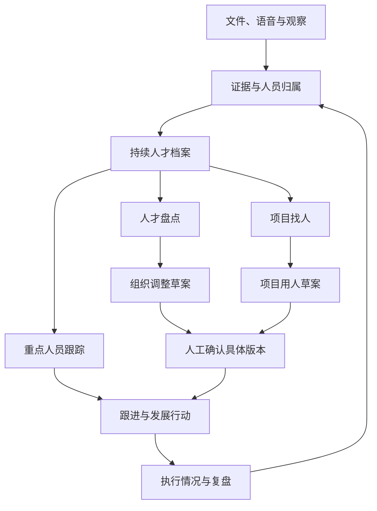

# 七牛云人才识别、追踪与盘点系统 PRD

## v1.0｜完整方案与讨论、决策记录

| 文档项 | 内容 |
| --- | --- |
| 整理日期 | 2026-10-23 |
| 产品工作名 | 同行 · 七牛人才工作台；“同行”为设计提案，尚未正式定名 |
| 业务范围 | 全公司人才识别、重点人员跟踪、人才盘点与组织调整、新项目找人、任用后复盘 |
| 首期场景 | 公司 Hackathon，用户要求三天交付 |
| 主要入口 | 企业微信内 H5，兼顾桌面浏览器 |
| 使用数据 | 用户提供的组织目录与职责；匿名模拟人员、经历和评价可用于比赛 |
| 阅读对象 | 项目负责人、HR、管理决策者、产品、设计、开发与验收人员 |
| 文档性质 | 汇总已确认需求，并提供可实施的设计默认；不代表所有设计细节已获逐项批准 |
| 当前交付状态 | 已有需求文档与局部交互概念；真实账号、后端权限、模型、录音和企业微信业务链路尚未联调验收 |

> 本文以用户后续明确决定作为一期范围基线，保留早期会议意见及其变化。功能规划、来源事实和实现状态分别记录，不能互相代替。

---

## 目录

1. [文档使用与状态说明](#1-文档使用与状态说明)
2. [产品背景、问题与价值](#2-产品背景问题与价值)
3. [原始材料解读：HR、CEO 与人才发展大图](#3-原始材料解读hrceo-与人才发展大图)
4. [用户、角色与使用场景](#4-用户角色与使用场景)
5. [一期范围与功能清单](#5-一期范围与功能清单)
6. [业务闭环与用户旅程](#6-业务闭环与用户旅程)
7. [数据对象与证据规则](#7-数据对象与证据规则)
8. [功能详细需求](#8-功能详细需求)
9. [人才维度、标签与判断标准](#9-人才维度标签与判断标准)
10. [AI 分工与轻 Agent 方案](#10-ai-分工与轻-agent-方案)
11. [长会议、语音和移动端](#11-长会议语音和移动端)
12. [权限与信息可见性](#12-权限与信息可见性)
13. [信息架构、UI 与交互规范](#13-信息架构ui-与交互规范)
14. [非功能要求与失败处理](#14-非功能要求与失败处理)
15. [模拟数据与比赛演示](#15-模拟数据与比赛演示)
16. [效果指标与验证方法](#16-效果指标与验证方法)
17. [验收用例](#17-验收用例)
18. [三天实施安排](#18-三天实施安排)
19. [风险、取舍与失败路径](#19-风险取舍与失败路径)
20. [待澄清与待验证事项](#20-待澄清与待验证事项)
21. [讨论过程记录](#21-讨论过程记录)
22. [决策记录](#22-决策记录)
23. [国内外产品与学术思想借鉴](#23-国内外产品与学术思想借鉴)
24. [组织目录附录](#24-组织目录附录)
25. [来源、追溯关系与现有产物状态](#25-来源追溯关系与现有产物状态)

---

## 1. 文档使用与状态说明

### 1.1 决策状态

| 标记 | 含义 | 执行方式 |
| --- | --- | --- |
| 用户已确认 | 用户明确提出或确认的目标、范围与约束 | 作为一期需求，不重复索取同一决定 |
| 来源事实 | 来自会议原文、PPT 或组织表的内容 | 支撑产品理解；不自动把全部管理蓝图转成一期功能 |
| 建议默认 | 为实现已确认目标而提出的产品或技术取舍 | 可按此拆任务推进；保留替换空间，不写成用户原话 |
| 待澄清 | 会改变业务规则、权限或产品承诺的信息缺口 | 采用文中默认或保留未知；只在影响具体动作时澄清 |
| 后续范围 | 已讨论但不作为本期交付要求 | 保留演进方向，避免无意加入三天工作量 |

### 1.2 验证状态

验证状态独立于决策状态，包括：用户提供事实、附件已核查、官方文档已核查、原型局部检查、实际接口未验证、完整业务未实现。

例如，七牛 MaaS 是用户指定的模型服务，但“某个实际模型与某版 SDK 已完成工具调用联调”目前仍未验证。

### 1.3 冲突处理

- 用户后续明确决定覆盖早期范围建议。
- 会议自动总结与逐字原文有差异时，以逐字原文作为本次解读依据。
- 会议转写仍可能含人名、缩写和术语错误；不静默补全或改成确定事实。
- 人才发展图是管理框架初稿，不是已经验证的评分模型。
- 产品建议需保留依据、适用边界和状态；需求文档不替代公司正式人事制度。
- 原始材料中的个人案例不直接用于公开比赛。演示人员、经历及评价均标为模拟。

---

## 2. 产品背景、问题与价值

### 2.1 已获访谈支持的问题

当前人才观察散落在 Excel、履历、活动材料、绩效记录、关键事件和 HR 与管理者的沟通中。组织需要人时，难以快速回答：

1. 谁在相关任务中展现过需要的能力？
2. 谁值得持续观察、获得新机会或调整工作？
3. 哪些材料支持判断，哪些只是印象？
4. 调岗、晋升和项目安排之后，最初的判断是否得到后续事实支持？

HR 还关注长期在同一岗位的员工获得新任务后的变化。原文不是“待岗员工”，也没有把这种状态等同于能力不足。来源：S1，00:00:13–00:03:48、00:08:26–00:09:39。

### 2.2 产品定位

为 HR、经理、管理决策者和员工提供一个持续积累人才证据、辅助用人判断、记录行动及复盘的工作台。

核心价值链是：

**工作事实与观察 → 可追溯的人才档案 → 面向具体任务的判断 → 人工用人结论 → 后续行动与复盘 → 更新档案。**

### 2.3 一期必须验证的价值瞬间

- **重点跟踪：**打开一位员工，知道为什么关注、近期发生了什么、下一次要观察什么。
- **项目找人：**输入项目目标，得到可比较、可查看依据、可继续沟通的人选。
- **人才盘点：**对明确范围形成有依据的组织调整草案，留下人工结论和行动。
- **员工使用：**补充自己的经历或意愿，能够看到被允许查看的跟进事项。
- **复盘：**从后续结果回到当初判断，理解哪些假设成立、哪些需要修正。

### 2.4 本期效果边界

访谈证明存在具体业务诉求，但尚未量化当前准备盘点耗时、推荐准确率或组织收益。比赛版应证明流程可用、证据可追溯、权限有效；模拟案例通过不证明真实人才识别准确率，也不证明组织效率因系统而提升。

---

## 3. 原始材料解读：HR、CEO 与人才发展大图

### 3.1 HR 需求到产品要求

| 原始表达与来源 | 产品含义 | 本期处理 |
| --- | --- | --- |
| 难以发现能解决特定问题的人；需要配置和激活人才。S1 00:00:13–00:00:57 | 找人与人才激活有明确业务目标 | 跟踪、盘点、项目找人全部保留 |
| 活动之外的日常关键事件也需记录。S1 00:01:46–00:02:51 | 一次比赛成绩不足以代表长期表现 | 跨事件、跨时间的人才档案 |
| 要看什么情况下取得什么结果、贡献是什么。S1 00:06:50–00:07:23 | 结果必须结合背景与个人作用 | 证据记录任务、角色、行为、结果和约束 |
| 评价模型仍在迭代，先摆事实抓数据。S1 00:07:37–00:08:03 | 先保证事实积累和可修正性 | 不把成熟统一评分体系设为一期前置条件 |
| AI 提炼标签，人工可以修改。S1 00:13:42 | 标签可生成、可解释、可修订 | 保存模型结果和人工修订记录 |
| 数据不足时，仍需人沟通评估。S1 00:12:07–00:12:37 | 自动分析不能冒充胜任判定 | AI 形成建议，人工确认正式结论 |
| 调岗、晋升后要继续观察。S1 00:14:29–00:15:32 | 任用之后还有业务链路 | 行动、结果与原方案关联 |
| 界面、上传、操作都要简单。S1 00:18:22–00:18:40 | 低录入负担是核心体验要求 | 上下文自动带入、结果直接可改 |

S1 中 HR 的发言标为“说话人2”，身份由用户说明；其中对 CEO 的表述属于转述，不能用作 CEO 原话。

### 3.2 CEO 的直接表达及落地解释

| CEO 原始发言定位 | 可以确认的管理诉求 | 本系统的设计落实 |
| --- | --- | --- |
| S3 00:11:11–00:12:45 | 在真实任务中形成价值判断；建立判断力、推动力等第一阶段档案 | 记录问题识别、取舍、推进、协作和结果证据 |
| S3 00:12:45 | 档案服务于负责人选择与后续任用 | 推荐负责人时单独说明统筹与判断依据 |
| S3 00:13:50–00:14:45 | 招聘、融入、长期判断相衔接；提到每半年更新档案 | 持续更新，并支持按周期形成快照 |
| S3 00:34:40–00:36:05 | 希望更多人提供有效输入、独立思考 | 区分提出问题、形成方案、推动落地与仅参与执行 |
| S3 00:39:21 | 组织问题先看合理分工，系统提供辅助 | 组织调整方案可以覆盖职责、协作和交接 |
| S3 00:47:45–00:50:01 | 任务需要探索性、业务价值、后续承接与优先级判断 | 复盘同时记录人员表现与任务、资源、优先级变化 |

右列是产品推导，不是 CEO 对具体软件页面或功能的逐项批准。会议中提及的拟议组织调整，不据此认定已经实施。

### 3.3 人才发展大图

S2 第 1 页的逻辑为“AI 时代变化 → 人才标准变化 → 选拔与培养方式变化”，包含三个发展阶段：

| 阶段 | 原图内容 | 系统中的用途 |
| --- | --- | --- |
| 人才选拔，进得来 | 校园初筛、XEngineer 入营选拔、实战作品、真实项目 | 保存来源、作品、活动及观察材料 |
| 人才培养与适配，立得住 | XEngineer 新工科计划、Landing 轮岗落位、持续观察与人岗适配 | 保存任务、轮岗和发展阶段的证据 |
| 人才发展，走得远 | 产品架构师、FDE／业务导向技术人才、商业架构师，向业务或销售负责人发展；未来 CEO 计划 | 表达发展方向、目标角色和后续行动 |

原图维度必须保留原名：

- **能力：商业、设计、工程。**
- **心性：内生动力、智慧力、坚毅力、领导力、开放性。**

图中未给出行为等级、权重、公式或测量效度。因此一期将其作为证据组织目录与观察维度，不直接生成八维总分或雷达分数。

### 3.4 已发现的资料冲突

- **Landing 对象：**PPT 写校招生；CEO 在 S3 00:54:51 明确纠正为所有七牛新人。本文采用后者。
- **未来 CEO 计划：**会议说明尚未运行，可以放在未来规划图中；不作为已经存在的运行流程。
- **八维与 CEO 用语：**“判断力、推动力”可以成为观察问题和标签，不擅自替换“智慧力”或扩成已批准的新维度体系。
- **盘点周期：**HR 提到半年或一年，CEO 提到半年更新档案；一期支持自选时间范围与专项盘点，不写死公司制度。

---

## 4. 用户、角色与使用场景

### 4.1 主要角色

| 角色 | 核心任务 | 使用频率假设 | 最关键结果 |
| --- | --- | --- | --- |
| HR | 汇集材料、跟踪重点人员、组织盘点、准备调整方案 | 持续积累，周期集中使用 | 资料齐备、判断有据、行动可追踪 |
| 经理／业务负责人 | 记录关键表现、找项目人员、评估安排效果 | 随事件、项目与复盘触发 | 明确可用人选和待沟通条件 |
| 管理决策者 | 看关键人才、比较方案、作出用人结论 | 项目启动或组织调整时 | 可审阅的依据与方案 |
| 员工 | 补充本人经历、表达意愿、查看允许可见的行动 | 材料新增或收到跟进时 | 了解自己的资料与下一步 |
| 技术管理员 | 配置账号、组织目录和服务参数 | 按需 | 系统可运行；不自动拥有业务数据权限 |

使用频率是设计假设，不是已测用户行为。技术管理员属于维护能力，不额外建设复杂业务角色体系。

### 4.2 比赛观众与账号

用户已确认预置独立账号，并绑定稳定人员 ID。比赛观众可使用员工账号参与体验，不另设一个能绕过权限的“观众角色”。

建议至少准备两名不同员工、两个不同团队经理、HR、管理决策者的演示账号，用于验证横向与跨组织边界。数量是测试设计默认，不是用户指定配额。

### 4.3 员工侧一期边界

员工账号与真实权限属于已确认要求；“本人经历、发展意愿、待办”是最小可用体验建议。完整内部竞聘市场、课程推荐、复杂职业路线规划属于后续范围。

---

## 5. 一期范围与功能清单

P0 表示一期必须形成可验收能力；其中实现细节仍以“建议默认”标记。用户提出的长会议多人录音纳入 P0 工作假设，具体容量和效果以联调合同为准。

| 编号 | 能力 | 优先级 | 主要来源／决策状态 |
| --- | --- | --- | --- |
| FR-01 | 真实组织目录与匿名人员基础档案 | P0 | U2-2、U4-5；组织附件已核查 |
| FR-02 | 独立账号、人员绑定、角色与范围 | P0 | U3、U4-1；权限矩阵为建议默认 |
| FR-03 | 文件上传、文字录入、来源保留 | P0 | U2-3；S1 00:12:40 |
| FR-04 | 短语音与长会议异步转录 | P0 | U2-3、U3、U4-4；长录音规格待验证 |
| FR-05 | 说话人、被讨论对象、证据归属核对 | P0 支撑项 | 多人录音的必要业务规则 |
| FR-06 | 人员画像、事件时间线与来源展开 | P0 | S1、S3；页面形态为建议默认 |
| FR-07 | AI 提炼、Jev 判断、可修订标签 | P0 | U2-5、U3、U4-4 |
| FR-08 | 重点人员跟踪与观察问题 | P0 | U2-1 |
| FR-09 | 项目需求卡与候选人匹配 | P0 | U2-1；S1 00:11:30 |
| FR-10 | 人才盘点范围、时间与依据快照 | P0 | U2-1、U2-6 |
| FR-11 | 组织调整草案、人工结论与版本 | P0 | U2-6 |
| FR-12 | 调岗、晋升、项目安排后的行动与复盘 | P0 | U2-7 |
| FR-13 | 员工本人资料补充与可见事项 | P0 最小体验 | 账号已确认；具体动作建议默认 |
| FR-14 | 低步骤工作台与轻 Agent 入口 | P0 体验目标 | U4；具体 SDK 为技术推荐 |
| FR-15 | 企业微信手机适配、已提交任务恢复 | P0 | U3、U4-3；恢复策略为建议默认 |
| FR-16 | 必要历史、操作留痕和错误恢复 | P0 支撑项 | 方案留档、权限、复盘的必要条件 |

### 5.1 一期明确不包含

- 内部 HR 系统 API 对接、全量同步，以及自动把本系统结论写回人事系统。
- GitHub、销售／打单系统等自动数据连接器；有关材料可先通过上传和手工录入进入。
- 独立原生 App；企业微信 SSO 不作为本期前提。
- 完整内部人才市场、岗位竞聘与多级申请审批。
- 招聘 ATS、培训 LMS、完整继任梯队平台。
- 通用多 Agent 平台、动态工具市场、自动操作终端或其他外部系统。
- 公司统一人才总分、自动晋升／调岗／淘汰、自动人格定性。
- 活力值、健康度、全公司组织效能因果模型。
- 把九宫格、复杂组织可视化或技能图谱设为交付前置条件。

这些边界用于控制实现复杂度，不删除跟踪、盘点、项目找人和任用后复盘四段已定业务。

---

## 6. 业务闭环与用户旅程

### 6.1 总体关系

### 6.2 重点人员跟踪旅程

1. HR 或经理选定人员，或输入“持续关注此人的跨团队推进表现”。
2. 系统带入人员与已有材料，形成关注原因、待观察问题、责任人及下一次跟进事项。
3. 新材料进入后关联到该人，提示新增依据和需要核对的信息。
4. 用户补充观察、调整关注问题，或查看过去判断与当前依据的变化。
5. 到复盘时记录新事实与后续行动。停止重点关注不删除历史。

### 6.3 项目找人旅程

1. 用户描述业务目标和要解决的问题。
2. 系统生成需求卡：目标、交付、角色、关键要求、约束。
3. 代码先处理权限与明确约束，模型检索和判断相关证据。
4. 展示候选人的适配任务、支持依据、缺口、本人意愿与可投入情况。
5. 用户比较、补充、增删人选，形成项目用人方案。
6. 有权用户确认具体方案；沟通、释放、交接、实际任用继续以行动跟踪。

### 6.4 人才盘点与组织调整旅程

1. HR 或有权管理者选择组织／人员集合、盘点目标及材料时间范围。
2. 系统生成本次人员清单、材料摘要、关注点、矛盾和缺口。
3. 用户补充信息或校正判断，形成逐人结论与组织层面问题。
4. 输出组织调整草案，包含调岗、晋升建议、负责人安排、职责协作调整、试任或继续观察等动作。
5. 人工修改后确认版本，冻结人员范围、主要依据和当时结论。
6. 行动执行后，跟踪个人结果及原团队、目标团队和协作影响。

### 6.5 任用后复盘旅程

从原方案进入复盘，自动带入当初目标、关键假设、依据及预计观察事项。用户补充实际执行情况和结果，系统整理变化，人工记录继续、调整或撤回建议。

未执行的安排应记录未执行及原因，不评价为员工任用失败。项目取消、资源减少和优先级变化也应作为背景保留。

---

## 7. 数据对象与证据规则

### 7.1 核心对象

以下为逻辑模型，可由少量数据表和 JSON 字段实现，不要求每个对象独立成为一个服务。

| 对象 | 最小字段 | 关系／规则 |
| --- | --- | --- |
| 组织 | 稳定组织 ID、名称、明确父级、分组、职责、版本 | 分组不自动视为正式上级 |
| 人员 | person_id、匿名显示名、组织、岗位、发展阶段 | 账号与人分离；同名不合并 |
| 账号 | account_id、绑定 person_id、角色、授权范围、状态 | 操作者身份来自服务端会话 |
| 材料 | material_id、类型、原件位置、上传者、上传时间、可见性、处理状态 | 原始材料可追溯；文件有版本 |
| 证据 | evidence_id、相关人员、事件时间、背景、行为、结果、来源定位、性质 | 允许多人关联；区分贡献角色 |
| 标签定义 | tag_id、名称、维度、适用条件、反例、规则版本 | 不靠每次提示词临时定义 |
| 模型判断 | 人员／问题、证据集合、输出、模型版本、规则版本、生成时间 | 与人工结论分别存储 |
| 重点跟踪 | 人员、关注原因、观察问题、责任人、状态、下一次事项 | 不是单纯收藏 |
| 项目需求 | 目标、交付、角色、要求、约束、发起者、版本 | 候选名单关联具体需求版本 |
| 盘点批次 | 目标、组织与人员快照、时间范围、证据截至时间、状态 | 范围变化留记录 |
| 方案版本 | 类型、涉及人员、建议动作、理由、缺口、影响、确认信息 | 项目用人／组织调整为不同类型 |
| 行动与复盘 | 关联方案、责任人、目标、期限、执行状态、结果、复盘结论 | 结果返回人才档案 |
| 操作记录 | 操作者、对象、动作、时间、版本及结果 | 保留关键写入和确认操作 |

### 7.2 证据的最小结构

- 谁：被讨论或发生行为的人员；不等同于说话人。
- 何时：事件发生时间；未知时明确为空或待核对。
- 在什么任务与条件下：目标、阶段、资源、难度及协作背景。
- 做了什么：本人角色、实际行为和贡献。
- 结果是什么：产出、业务结果或尚未观察到结果。
- 谁提出、来源在哪里：观察者、材料、段落／页码／单元格／录音时间点。
- 属于什么信息：可核查记录、员工自述、管理观察、模型推断、人工结论。
- 谁能看：人员范围和材料可见性。
- 有什么不确定：人物、时间、事实冲突及待补材料。

### 7.3 证据规则

1. 上传时间不能自动当作事件发生时间。
2. 绩效材料含有评价成分，不能仅因来自 HR 系统就标为完全客观。
3. 同一事件在多份材料中出现时可关联来源，不能当作多个独立成功案例累计。
4. 团队结果与个人贡献分开；不能把团队所有成果复制给每位成员。
5. 未观察到某项能力与存在反向证据分别表示。
6. 人工修订生成修订记录，原文及此前判断仍可追溯。
7. 新证据更新当前视图，但不改写历史已确认方案的依据快照。
8. 复盘材料带实际时间和入库时间，不能被回填为当时已知信息。
9. 组织归属变化保留历史；历史盘点不跟随当前组织名称或人员归属静默重算。
10. 材料中的命令、角色冒充或“忽略权限”等文本只能被当作待分析内容，不能作为系统指令执行。

---

## 8. 功能详细需求

### FR-01 组织与人员基础

- 导入附件明确的组织、子级关系和职责。
- 用稳定人员 ID 关联账号、材料、观察、方案与行动。
- 支持按组织、岗位、姓名／匿名编号查找。
- 没有提供的负责人、职级和汇报线使用明确模拟配置或保留未知。
- 部门职责用于理解任务需求，不直接生成员工能力标签。
- 一期不建设组织编制、薪酬或劳动合同管理。

### FR-02 账号与访问

- 预置独立账号，成功登录后绑定服务端身份。
- 角色、组织范围和可见性由后台数据决定。
- 客户端更换人员 ID、任务 ID 或提示词不能改变授权。
- 登录失败、会话过期有简洁提示；重新登录后可回到原任务。
- 不把 UI 的“角色切换”当作权限实现。

### FR-03 材料录入

建议最低覆盖本次材料格式：文字／TXT／Markdown、DOCX、PPTX、XLSX，以及 FR-04 约定音频。PDF、扫描 OCR、视频内容理解等不自动扩为本期承诺。

- 支持从人员页、项目页或工作台上传；已有上下文自动带入。
- 上传后显示文件、任务状态和结果归属。
- DOCX／PPTX 保存段落或页码；表格保存工作表与单元格定位。
- 原始内容与提取结果分别保存，允许纠正解析错误。
- 不支持格式、损坏、加密或无法可靠提取时明确说明处理失败或需要补充。
- 文件大小、音频时长等限制在上传前展示；最终产品上限见待验证项 O-04。
- 不批量抓取或自动连接内部系统；手工导出材料可按权限上传。

### FR-04 语音与长会议

- 短语音用于随手记录；长会议优先上传已经录制完成的文件。
- 听悟异步处理，系统持久保存任务和归属。
- 已提交并取得业务任务号后，关闭页面不取消任务。
- 上传尚未完成即关闭页面，不承诺后台已经收到文件；重新进入应区分未提交与处理中。
- 仅对实际有歧义的人员或片段要求核对。
- 手机长时间锁屏录制、实时会议机器人、声纹库不是一期承诺。
- 转写、说话人分离和人才事实提取分别标识，不混成一个“识别成功”。

### FR-05 人员与证据归属

- 保存 speaker_id、发言者 person_id、被讨论 person_id 三个不同概念。
- 支持一位发言者讨论多人，以及多人共同参与同一事件。
- 名称、别名、上下文无法唯一映射时标为待核对。
- 确定部分继续归档；不因一处歧义阻塞整个会议。
- 手工纠正映射后，相关衍生判断失效或重算；历史正式结论保留并显示来源修订。
- 不能用说话语气或供应商对话角色标签推断真实员工身份。

### FR-06 人员档案与时间线

- 展示岗位和组织、经历与贡献、能力证据、发展意愿、跟踪事项。
- 默认呈现近期变化和与当前任务相关的信息。
- 支持展开原文定位；受限材料按第 12 节执行。
- 区分“本人补充”“管理观察”“AI 建议”“人工结论”。
- 能看到当前标签的依据和必要修改记录。
- 不把一次负面事件永久固定为整个人的标签。

### FR-07 标签与模型判断

- MaaS 提取与整理候选事实；Jev 核对已定义标签或项目条件。
- 标签包含名称、维度、证据、时间范围、规则版本及判断状态。
- 人工可以给人员添加已有标签、修订、取消或标记待核对；自动记录修改人、时间与前后值。普通修订理由可选，已在自然语言中说明的直接复用。
- 新词项可先作为自由观察或“规则待定”的候选标签保存；没有定义标准前，不显示为已有 Jev 判断。完善少量标准通过配置完成，不增加标签治理平台。
- 普通标签建议不逐条弹审批；正式管理结论仍通过方案确认。
- 不以模型 confidence 显示员工能力百分比。
- 无材料、材料冲突、来源失效和服务失败分别处理。

### FR-08 重点人员跟踪

- 可从人员页、候选名单、盘点页或自然语言建立跟踪。
- 明确关注原因与具体观察问题，例如“能否独立推动跨部门问题闭环”。
- 记录负责人、下一次跟进日期或触发事件、当前状态。
- 新材料显示“新增了什么”，帮助比较此前与当前判断。
- 本期提醒以工作台待办和到期状态为默认；企业微信主动消息推送属于后续集成。
- 取消关注保留历史，不影响正常人员档案。

### FR-09 项目找人

项目需求卡的最小字段为目标、需要承担的角色、主要交付、关键要求和已知约束。系统先从自然语言提取，用户可在结果中直接修改。

候选卡至少包含：

- 建议承担的角色或任务。
- 与具体要求对应的支持依据。
- 反向证据或尚缺的经历。
- 本人意愿、可投入时间和当前安排；未知不自动填“同意”或“空闲”。
- 下一步沟通或补证事项。

规则：

- 明确硬约束由代码筛选；模型进行语义判断。权限不足、已知不满足业务条件、条件未知分别处理；未知不能当作反向证据。资料尚缺的人可进入“条件待确认”列表，进入正式安排前再核对关键条件。
- 负责人和专业执行者分别解释适配理由。
- 不把材料数量、现岗绩效或个人技术产出直接等同于带队能力。
- 支持手动补人、删人、调整角色和加入方案。
- 没有合适人选时展示缺口与补充材料建议，不强行推荐。
- 排序服务于本次任务，不生成全公司人才总榜。

### FR-10 盘点准备

- 输入盘点目标、人员／组织范围、时间窗口。
- 生成明确人员清单，范围有变更时留记录。
- 汇总经历、能力证据、发展方向、意愿、可投入状态和主要分歧。
- 标记资料不足的人，不把他们默认归入低潜或低绩效。
- 支持逐人修改结论及形成组织层面观察。
- 草稿阶段可主动补证、调整人员范围或材料截止时间，并保存变更记录；不随每次打开自动扩入新材料。确认时冻结该版本的范围、截止时间与实际依据；后续材料进入新的草稿或版本。
- 本期可采用结构化人员清单，不要求九宫格先行。

### FR-11 调整方案与人工结论

方案类型区分组织调整和项目用人，编辑与版本能力共用。

组织调整草案最小内容：

1. 调整目标与业务理由。
2. 涉及组织、人员及原安排。
3. 拟议动作：调岗、晋升建议、负责人安排、职责调整、试任或继续观察。
4. 支持依据、反向证据、资料缺口。
5. 本人意愿、可释放情况及待沟通条件。
6. 原团队与目标团队影响、交接或协作事项。
7. 人工结论。
8. 后续行动、责任人、观察目标和复盘日期；尚未确定的行动标为待安排。

确认规则：

- 草稿自动保存；授权用户确认当前具体版本一次即可。
- 确认时冻结人员范围、主要依据、人工结论、确认人、时间和后续行动。
- 确认不等同于实际完成调岗、晋升或项目任命。
- 正式确认同时要求 confirm_plan 动作权限，且方案所有涉及人员都在操作者授权范围内。比赛默认授予指定 HR 和管理决策者；经理只有被明确授予该动作权限后才能确认，不按职位名称自动放行。
- 后续实质修改生成新版本；旧版本不被覆盖。
- 同一确认请求重复发送不重复产生行动；行动保留稳定标识，新方案版本中未变化的行动继续关联，不重新创建。已经执行的行动不能因方案改版被静默改写，变更通过修订记录或新行动表达。
- 多人编辑时至少检查版本冲突，不静默覆盖他人修改；不要求实时协同编辑。

### FR-12 行动与复盘

建议动作状态为：待沟通／待安排、进行中、已执行待观察、已复盘、未执行／取消。

- 来自方案的行动绑定原方案及版本；独立的人员跟踪行动绑定人员或跟踪对象，允许后续关联方案，不要求先创建正式方案。
- 区分预计日期、实际执行日期和复盘日期。
- 记录预期改变、观察指标或事实、实际结果与背景变化。
- 未执行记录原因，不能记作个人表现失败。
- 复盘比较当时判断与后续事实，记录继续、调整或撤回建议。
- 同时允许记录原团队影响、目标团队影响和协作问题；一期不自动计算公司整体效能因果结论。

### FR-13 员工自助

- 员工可查看本人允许可见的材料、发展意愿和已向本人开放的行动。
- 可补充经历、自述、作品与意愿，来源标为本人提供。
- 可以补充纠正说明；不能直接改写他人观察原文或管理结论。
- 不默认展示针对本人的保密管理评价、未确认晋升草案或其他员工资料。
- 本期不要求完整公开职位市场和竞聘流程。

### FR-14 轻 Agent 与工作台

- 一句话可以发起查询、记录、找人、盘点或跟进。
- 明确授权的普通记录直接保存，支持撤销。
- 分析自动形成可编辑草稿，重要结果有持久业务对象。
- 查看、选择、编辑、确认仍有直接按钮，不能强迫用户为每个动作输入一段话。
- 身份、权限和正式确认由后端保证。
- 信息不足时保留已完成结果，只追问影响下一步的关键问题。

### FR-15 移动端

- 企业微信内完成登录、文字／短语音、文件选择、进度查看、依据展开、草稿编辑及确认。
- 常用动作在单列页面完成；复杂多人比较允许桌面更高效。
- 已保存记录和已提交任务跨页面、重新登录后可恢复。
- 实际 iOS／Android 企业微信兼容性需联调；响应式 CSS 不等于已完成真机验证。
- 录音权限不可用时提供文字或文件上传路径。

### FR-16 历史与运行留痕

- 保存关键操作的操作者、对象、时间、结果及版本。
- 至少记录材料导入、归属纠正、标签修订、正式确认、行动和复盘。
- 保存模型与规则版本、失败类型，便于追查；避免把大量敏感原文复制到通用日志。
- 撤销普通观察需要记录撤销状态；若已被确认方案引用，保留历史引用并提示后续修订。
- 必要统计先通过日志或简单汇总实现，不追加运营大屏。

---

## 9. 人才维度、标签与判断标准

### 9.1 三层组织方式

| 层次 | 内容 | 本期用途 |
| --- | --- | --- |
| 稳定维度 | 商业、设计、工程；内生动力、智慧力、坚毅力、领导力、开放性 | 沿用人才发展图的概念目录 |
| 工作能力与经历标签 | 例如需求拆解、跨团队推进、故障定位、实验设计、项目统筹 | 帮助检索、组织证据和解释适配 |
| 具体任务要求 | 例如本项目需要协调销售与研发、在限定时间推进交付 | 用于本次候选比较 |

第二、三层为实施设计，不宣称存在一套已经批准的公司标签全集。

### 9.2 标签标准

每个预置标签建议有：名称、含义、支持行为、反例、不能据此推断什么、适用任务、规则版本。

例如“跨团队推进”需要材料说明协调对象、障碍、个人采取的行动和推进结果。“参加跨部门会议”本身不足以支持该标签。

“判断力”可以观察如何定义问题、选择目标、比较方案与根据新证据调整；“推动力”可以观察如何处理障碍、协调资源和完成闭环。这些是观察提示，不是自动人格结论。

### 9.3 判断状态

应用统一呈现四种证据判断状态：

- 支持：现有材料对该项要求有明确支持。
- 不支持：已有足够相关信息，明确表明在所述事件中未满足标准，或存在明确反例；不外推为稳定能力结论。
- 资料不足：缺少关键行为、结果或情境，无法评价。只有参与记录、没有具体贡献的信息归此类，不能归为反向证据。
- 证据冲突：存在方向不一致的材料，需要进一步核对。

这四种是应用层状态，不能把它们描述为所有 Jev 接口天然返回的固定字段。过程状态如“处理中、失败、规则待定”另行保存。

### 9.4 心性相关维度的边界

心性维度应关联可描述的工作行为和情境，允许未知与修正。不能根据语气、一次沉默、单次失败或材料少，直接得出稳定人格、健康或动机结论。

### 9.5 规则迭代

一期使用小规模预置词表和可修改定义，不建设通用规则编辑平台。保留规则版本；规则变化后的重新分析产生新结果，不覆盖旧盘点当时的判断。

工程规范在会议中被提及，但当前没有收到独立标准文件。未取得标准前，不生成“符合七牛工程规范”的确定性结论。

---

## 10. AI 分工与轻 Agent 方案

### 10.1 已确认路由与推荐实现

| 事项 | 状态 | 方案 |
| --- | --- | --- |
| Jev 服务 | 用户确认 | TypeSafe AI 的决策模型，用于有边界的判断 |
| 语音服务 | 用户确认方向 | 通义听悟，承接录音转写 |
| 其他模型服务 | 用户确认 | 七牛云 MaaS API |
| Agent SDK | 助手推荐，待联调 | Vercel AI SDK 的 ToolLoopAgent |
| 模型接入 | 助手推荐 | OpenAI-compatible provider，使用七牛 Chat Completions |
| 助手数量 | 建议默认 | 一个主助手，有限业务工具 |
| 具体模型 ID、SDK 版本 | 待联调后锁定 | 不把动态别名或最新版写成长期稳定合同 |

七牛官方列出接入地址 [https://api.qnaigc.com/v1](https://api.qnaigc.com/v1) 和 Chat Completions，并提供工具调用及流式相关字段。AI SDK 官方支持自定义兼容 provider 和工具循环。接口存在不代表每个托管模型支持所有特性，组合需实际验证。来源：T6、T7。

### 10.2 Jev 的真实能力与适用位置

官方文档说明 Jev 接收状态与类型化问题，支持 Choice、Score、Noul，返回类型化结果及相应概率信息，不负责自由文本生成。它适合明确、局部的判断，复杂综合问题宜拆分。来源：T1。

| 环节 | Jev 可以承担 | 其余责任 |
| --- | --- | --- |
| 标签 | 判断给定证据是否支持已定义标签 | MaaS 提取事实；HR／产品维护标准 |
| 项目匹配 | 按每项角色要求判断证据支持情况 | 代码处理硬条件；MaaS 整理解释 |
| 盘点准备 | 识别相关依据是否充分或存在冲突 | HR 校准、人工结论、组织方案 |
| 复盘 | 按原目标核对新材料是否支持原假设 | 人工理解情境与作出后续安排 |

Jev 的 confidence 是输出分布的统计，不是员工能力分、岗位胜任率或已验证正确率。不得将其显示为“某人领导力 93%”。来源：T2。

官方模型文档提醒英文表现较好；中文业务材料必须单独验证。Jev 1.13 的已知限制包括精确计算、时间比较、间接推理和大量无关信息；这是特定版本说明，不能不加区分地推断所有后续版本表现。日期、计数、权限、硬约束由代码处理。来源：T3、T4。

### 10.3 最小工具集合

| 业务工具 | 做什么 | 重要边界 |
| --- | --- | --- |
| search_people | 查找授权范围内候选人 | 服务端限制数据范围 |
| get_evidence | 取与问题相关且允许读取的材料 | 不将整库交给模型 |
| evaluate_with_jev | 核对标签或任务要求 | 记录证据、规则与模型版本 |
| save_draft | 保存或更新项目／盘点／调整草稿 | 不自动成为正式结论 |
| add_observation | 保存用户明确要求记录的观察 | 对象与权限明确，支持撤销 |
| create_followup | 记录跟进事项 | 绑定人员或方案；未知责任人标待安排 |

录音上传、任务状态查询、最终方案确认可由普通业务接口完成，不必把所有功能都包装成 Agent 工具。

### 10.4 最短实现路线

- 一个 H5／Web 前端，一个业务后端，一套持久数据与文件存储。
- 固定角色与授权数据；不建设通用权限平台。
- 结构化筛选、关键词／全文检索先取相关材料，再交给模型；向量库不是前置条件。
- 主助手限定工具、循环次数、超时和结果数量。
- 有副作用的业务写入使用跨网络重试保留的业务操作 ID；同一操作重试返回原结果，不重复落库。该 ID 不能只依赖每次模型重新生成的 tool-call ID。
- 材料解析、录音处理、落库与重试采用明确的后台流程。
- 会话保存必要上下文，事实与方案保存为业务对象。
- API 密钥仅在服务端使用；不进入客户端或模型可读材料。
- SDK 与模型版本在联调通过后固定，避免混用不同版本示例。

### 10.5 明确的执行语义

| 请求类型 | 行为 |
| --- | --- |
| 查询和分析 | 在授权范围内直接执行 |
| 对象、内容明确的记录或跟进请求 | 直接保存，回显结果，允许撤销 |
| 找人、盘点、组织调整分析 | 自动生成和保存草稿 |
| 模型自行提出任用建议 | 留在草稿，不执行人事动作 |
| 有权用户确认具体版本 | 一次完成正式结论留档及行动创建 |

### 10.6 第一日需要实际验证的最小组合

七牛指定模型的工具调用往返与流式；Jev 的中文小样本判断及未知／冲突状态；听悟任务提交与结果；企业微信上传、短语音与登录恢复。用户已说明 API 可解决，这些是开发验证项，不再作为重复的业务准入问题。

---

## 11. 长会议、语音和移动端

### 11.1 长会议处理链路

直接调用听悟 API 可以承担长音频转录和说话人分离，但产品还需要完成任务状态、人员核对、证据归属、权限与结果入库。技术接入与业务可用应分别验收。

建议链路：上传录音 → 创建转录任务 → 等待结果 → 保留带时间点的转写 → 提取人物与事件 → 只核对关键歧义 → 生成可追溯证据。

| 状态 | 用户看到什么 | 可执行动作 |
| --- | --- | --- |
| 上传中 | 文件名与上传进度 | 取消；失败后重新上传 |
| 已提交／排队中 | 已保存的任务及提交时间 | 离开页面，之后返回 |
| 转录中 | 正在处理；不显示虚构进度百分比 | 查看任务状态 |
| 整理中 | 转写已完成，正在提取人物与事件 | 查看已授权的转写 |
| 部分待核对 | 可用内容及具体疑点 | 核对人物、时间或指代 |
| 已完成 | 本次新增证据、涉及人员和来源 | 查看人员档案；修正 |
| 失败 | 失败阶段及已保留内容 | 重试该阶段；改用文字材料 |

“部分待核对”不必阻塞整场会议。已明确归属的内容可先保存；无法确定的内容进入待核对列表，不分配给猜测的人员。

### 11.2 文件规格与第三方边界

听悟离线转写官方文档列出单文件不超过 6 GB、时长不超过 6 小时，并支持通过可访问的音视频 URL 提交；这些是服务侧文档限制，不是本产品已实现或承诺的处理能力。实际配额、格式、链接有效期、网络与后处理仍需联调。来源：T5。

一期建议：

- 优先完成文件录音的异步处理，采用服务端任务 ID 持久保存状态。
- 私有原件通过有时效的授权链接供转录服务读取；链接有效期覆盖排队与下载。此链接仅供服务端与转录服务使用，不返回给普通用户。
- 用户查看或播放原件、录音与结果经过本系统实时鉴权接口；不提供绕过当前权限检查的对象存储直链。已下载到用户设备的内容无法通过撤权收回，撤权控制后续服务端访问。
- 状态以服务返回和后端记录为准，轮询或回调选择一种可靠实现即可。
- 转录与后续模型提取分别重试；重复回调不能重复入库。
- 原转写与修正版区分保存，引用定位对应正确版本。
- 演示验收建议使用一段 60–90 分钟、至少 3 位说话人的录音；这是建议样本规格，不是用户确认的最终产品上限。
- 产品允许的格式、大小、时长、并发和超时在第一日联调后固定，并在上传入口说明。

短语音用于当场记录一条观察；长录音用于上传已有会议文件。手机后台持续录制数小时、自动加入会议和系统通话录音不进入本期。

### 11.3 三种身份必须分开

| 身份 | 示例 | 系统规则 |
| --- | --- | --- |
| 转录说话人 | Speaker 1 | 是说话人分离／聚类编号，可来自同一音轨；不代表独立音轨，也不等于真实员工 |
| 发言员工 | 匿名人员 A | 用户核对后才能绑定稳定人员 ID |
| 被讨论员工 | A 在发言中提到匿名人员 B | 该表现证据可能属于 B，而非 A |

听悟提供的身份相关能力也不能直接当作企业人员 ID 识别。官方相关示例包括根据上下文识别“销售／客户”等角色，仍需本系统核对人员身份。来源：T5。

对同名、简称、代词、多人重叠发言、跨部门同姓等情况：

- 允许标为未知；不知道谁说的不等于知道被讨论者是谁。
- 根据明确文本提取被讨论者，保留观察者和来源。
- 关键人员无法确定时，展示候选身份及依据，让用户做一次选择。
- 修正人物绑定后，使受影响的当前标签与匹配结果失效或重新计算；历史方案继续保留当时依据和修订提示。

### 11.4 企业微信与手机体验

采用适配企业微信内打开的 Web／H5 页面，独立预置账号登录。企业微信是主要访问入口，本期不以企业微信单点登录或通讯录同步为前置条件。

手机端优先保证四件事：快速记录、查看人物、处理待核对项、查看和确认有权操作的方案。复杂的多人对比与组织调整编辑在桌面端更完整。

建议适配 320–430 px 的常见手机宽度；候选对比在手机上改为纵向卡片，不挤成横向大表。至少在实际使用的 iOS 和 Android 企业微信客户端验证登录、文件选择、短语音、任务返回和方案操作。

恢复规则：

- 后端已接收并持久化的录音任务，关闭页面后继续处理；重新进入可找回。
- 文件尚未上传完成时，不承诺后台继续上传或跨浏览器恢复；离开前明确提示当前状态。
- 已保存草稿返回后恢复；尚未保存的本地输入给出可识别状态。
- 麦克风权限被拒或客户端不支持录音时，提供文字输入和文件上传。
- 不把企业微信的客户端限制写成模型错误，也不在手机端反复要求填写已有组织、人员与项目资料。

---

## 12. 权限与信息可见性

### 12.1 最小权限模型

账号独立、绑定人员 ID、权限进入一期验收，均已由用户确认。下列具体矩阵属于可实现的建议默认，正式真实数据上线前由 HR 确认。

采用“角色允许的动作 + 授权人员／组织范围 + 内容可见性”共同决定访问，任一条件不满足就拒绝。公司组织结构不自动等同于授权范围。

| 角色 | 本人可见资料 | 项目用专业资料 | 管理观察与盘点依据 | 方案确认与行动 |
| --- | --- | --- | --- | --- |
| 员工 | 查看、补充本人允许可见部分 | 默认本人；不开放全员自由检索 | 不可查看隐藏管理评价、他人盘点或排序 | 查看向本人发布的行动，补充本人反馈 |
| 经理／业务负责人 | 本人权限同员工 | 可检索被授权共享的跨组织专业资料 | 仅显式授权团队／人员范围 | 默认起草；另获 confirm_plan 权限后可确认授权范围内方案 |
| HR | 本人权限同员工 | 按授权范围查看，比赛默认全公司 | 按授权范围组织盘点与审阅材料 | 指定演示账号有 confirm_plan 权限，在授权范围内形成结论与后续行动 |
| 管理决策者 | 本人权限同员工 | 按授权范围查看 | 按授权范围查看 | 指定演示账号有 confirm_plan 权限，在授权范围内确认方案 |
| 技术管理员 | 只因维护身份不获得业务资料 | 无默认读取权 | 无默认读取权 | 配置账号和参数；业务操作需另行授权 |

演示中 HR 和管理决策者可设置全公司范围；这是演示配置，不据此推断真实公司每个岗位的权限。

### 12.2 内容按用途授权

至少区分三类用途：

1. **本人可见**：本人经历、本人意愿、已向本人公开的反馈和行动。
2. **项目用专业资料**：允许用于项目寻找与协作的经历、技能证据及意愿。
3. **管理受限资料**：管理观察、校准讨论、盘点结论、组织调整草案与未公开任用建议。

它们是可见用途和授权标记，不必做成互斥的三类文件。一条专业经历可以同时向本人和项目负责人可见；一场包含多人评价的会议不能仅因关联本人就整场向其公开。

### 12.3 必须覆盖的访问入口

权限检查必须在服务端执行，覆盖：

- 人员列表、搜索结果、详情与来源片段。
- 模型检索、上下文构建、Jev 输入及生成结果。
- 材料原件、录音、转写、下载链接。
- 后台任务、任务状态、生成后的结果读取。
- 草稿、方案版本、人工结论、行动与复盘。
- 对象 ID 直接访问、写入接口和跨账号缓存。

先过滤有权访问的证据，再交给模型；不能将整库提交后只在页面上隐藏结果。模型不能替代服务端做授权决定。

### 12.4 来源与衍生内容的规则

- 用户能看一条获授权的摘录，不表示能下载含有其他人管理信息的原文件。
- 整份材料无权开放时，只返回经过授权的片段和允许显示的定位信息，或明确说明来源受限。
- 从受限证据生成的总结、标签与推荐继承相应限制，不能通过“摘要”绕过原件权限。
- 将管理材料整理成可共享专业经历，需要有权人员明确发布一个可共享版本，不能自动降级可见性。
- 人员换组、账号停用或授权撤销后，新请求按当前权限判断；历史快照保留不等于原访问者永久有权读取。
- 异步任务完成时重新校验结果读取权限。任务创建者失去权限后，不能通过旧链接继续查看。
- 员工能够提出资料纠错；不能直接修改或删除他人的管理观察和已确认结论。

本期用固定角色、简单授权表和几类可见标记完成即可，不建设通用策略语言、复杂审批流或多租户平台。

---

## 13. 信息架构、UI 与交互规范

### 13.1 设计目标

界面应让人先理解“这次要解决什么人和事的问题”，随后再看证据、作判断和安排下一步。降低输入和跳转次数，同时让依据与人工责任可见。

工作名“同行”为设计提议，尚未作为正式产品名称确认。比赛介绍可以继续使用“七牛云人才识别、追踪与盘点系统”。

### 13.2 页面结构

| 入口／页面 | 核心内容 | 主要操作 | 设计取舍 |
| --- | --- | --- | --- |
| 工作台 | 一句话任务入口、最近任务、待核对和待跟进 | 记录观察、上传材料、发起找人或盘点 | 不以大量统计卡片占据首屏 |
| 人才 | 有权限的人员、重点关注、可用筛选 | 搜人、看档案、加入跟踪 | 先显示名字、角色、近期事件与下一步 |
| 人员档案 | 摘要、时间线、证据、判断、行动 | 展开来源、补充记录、纠错 | 当前判断与历史证据分层 |
| 项目任务 | 需求卡、候选人、条件和方案 | 修改关键要求、比较、手动补人 | 项目建议与人才盘点是不同业务对象 |
| 盘点 | 批次、范围、资料缺口、讨论与方案 | 固定范围、补依据、形成组织调整方案 | 不把项目候选名单当作完整盘点 |
| 方案／复盘详情 | 依据、人工结论、版本、行动、后续结果 | 确认具体版本、安排复盘、记录结果 | 草稿与正式记录状态明显 |
| 员工首页 | 本人资料、发展意愿、公开行动 | 补充经历、反馈、更正本人资料 | 不展示经理的盘点工作台 |

桌面主导航建议保留“工作台、人才、盘点”三项。项目与方案可从工作台最近任务和上下文进入；移动端保留相同概念，减少层级。

### 13.3 低步骤交互规则

- **观察录入**：用户说“记录一下，人员 A 在这次故障中……”，系统提取人员、事件与时间，只询问关键歧义。
- **项目找人**：先接收自然语言，再生成可直接编辑的需求卡；已有条件不要求重新填表。
- **盘点准备**：输入“为某团队准备本季度盘点”，系统带入组织与时间，展示一次范围核对。
- **方案确认**：草稿持续保存，人工修改后对当前版本确认一次；不逐条确认全部 AI 标签。
- **直接记录**：用户已经明确要求保存且对象无歧义时，保存后回显并提供撤销；分析性问句不自动变成正式结论。
- **信息复用**：从人员页发起观察，自动带入该人；从项目页发起匹配，自动带入当前需求版本。
- **渐进展开**：摘要、推荐理由与缺口默认可见；长来源、历史版本和模型信息按需展开。

建议交互验收：一个明确的观察记录无需额外完整表单；一个信息充分的项目请求不经过必填多页向导；一个已经审阅的方案只需一次确认。存在同名人员、无权限或必要条件缺失时，可追加最少必要问题。

### 13.4 候选人与证据的展示

候选卡优先展示四项：

1. 适合承担的具体角色。
2. 与需求直接相关的两三条证据及时间。
3. 需要补充或存在冲突的条件。
4. 意愿、可释放情况以及下一步沟通建议。

不显示没有校准依据的“综合人才分 92”“潜力超过 97% 的同事”。可以按明确任务条件给出相对推荐顺序，但同时展示条件、证据和缺口；不同任务之间不复用成全公司排名。

证据卡使用“背景—行为—结果—来源”结构，并明显标注自述、观察、模型推断或人工结论。不能靠低对比度灰字隐藏重要不确定性。

### 13.5 视觉方向与细节

建议采用克制的工作台风格：温暖浅色背景、深色正文、单一蓝色主强调色、充足留白和稳定的字体层级。重点通过结构与文字建立可信度。

- 状态色只表达处理状态、风险或待核对，不把“人”永久标成红黄绿等级。
- 时间线使用真实事件时间；未知时间明确显示，不造日期填满视觉。
- 对比优先使用可读的证据清单与差异高亮，不默认放雷达图和无定义九宫格。
- 关键按钮文案采用“保存观察”“生成草稿”“确认此版本”“记录复盘”，避免“智能赋能”“一键洞察”等空泛措辞。
- 加载时说明阶段；失败时保留输入并给出可执行下一步；空状态展示一个贴近场景的示例。
- 键盘可操作，表单有可见标签，状态除颜色外有文字；手机保持适当触控面积和文字可读性。
- 技术实现、模型路由与 SDK 名称放在必要的运行记录里，不进入正常用户任务流程。

现有概念原型可以作为局部风格和交互参考；其能力与验证状态见第 25 节，不能视作上述页面与流程均已交付。

---

## 14. 非功能要求与失败处理

| 方面 | 一期要求 | 不承诺的内容 |
| --- | --- | --- |
| 持久化 | 录入记录、任务、草稿、确认版本及行动重启后仍可读取 | 不以仅存浏览器内存的演示代替 |
| 响应 | 录入有及时状态反馈；长任务异步处理；有保存状态 | 未压测前不承诺固定秒数和全公司并发 SLA |
| 一致性 | 写入操作和确认幂等；版本冲突可见；重复回调不重复建证据 | 不要求多人实时共同编辑 |
| 权限 | 服务端统一检查；错误不泄露他人内容；秘密参数留在服务端 | 不建设复杂企业 IAM 平台 |
| 可追溯性 | 证据能定位来源；正式方案留范围、依据、人工结论及行动 | 不要求保存模型私有推理过程 |
| 可恢复性 | 失败保留已保存阶段；按阶段重试；输入不无故丢失 | 不承诺网络断开时所有浏览器上传都能续传 |
| 可观察性 | 记录任务 ID、阶段、错误类型、模型／规则版本与关键操作 | 不建设完整运维分析产品 |
| 可访问性 | 基本文字对比、键盘操作、状态文字、手机触控可用 | 不在未测试前宣称通过某一外部认证 |
| 数据范围 | 使用用户允许的匿名模拟人员及必要组织资料 | 未获得材料与授权时不接入真实全量 HR 数据 |

模型失败处理：

- 七牛生成失败：保留原输入与已保存对象，允许重试或人工完成。
- Jev 失败：显示“判断暂未生成”，保留证据；不能偷偷用另一模型输出冒充 Jev 结果。
- 听悟失败：保留原文件与任务信息，允许重新提交或上传已有文字转写。
- 来源不足：显示缺口或继续观察，不补写看似合理的经历。
- 工具参数无效、超出权限或循环过多：停止该工具调用，说明尚未完成的具体动作。
- 任务超时：与业务对象状态分别记录；区分未执行、已落库但响应中断、执行失败。同一业务操作重试读取原结果，避免重复观察、跟进或方案；用户主动新增一次记录则分配新操作 ID。

具体超时、重试次数与服务容量由第一日联调确定；配置集中管理，不向普通用户暴露实现参数。

---

## 15. 模拟数据与比赛演示

### 15.1 数据集建议

采用真实组织名称与职责，人员、事件、评价和方案使用匿名模拟数据。文件与页面标注“演示数据”，防止将模拟评价误认为公司员工真实结论。

建议准备约 60 名匿名人员，其中约 12 名具备完整事件与复盘材料，覆盖三条主线；其余人员用于验证全公司目录、资料不足和权限边界。人数是演示设计默认，非公司实际规模。尽量覆盖附件中 29 个叶子组织，不凭此推算真实编制。

必须包含的差异样本：

| 样本 | 用于验证什么 |
| --- | --- |
| 同名或简称相似的两人 | 稳定人员 ID 与归属核对 |
| 技术贡献强、公开表达少的人 | 不能只奖励会议发言多的人 |
| 当前岗位产出高、目标管理职责证据不足的人 | 区分当前表现与目标岗位准备度 |
| 经历匹配但暂不可释放／无意愿的人 | 推荐不能只看技能标签 |
| 同一事件重复上传或多渠道提及 | 去重与独立证据计数 |
| 自述与经理观察有冲突的人 | 保留不同来源与分歧 |
| 新加入、资料少的人 | 未知不能被解释为低潜力 |
| 项目结果不佳但资源和目标发生变化 | 复盘不把所有结果归因于个人 |
| 管理受限证据与可共享经历并存的人 | 摘要、来源和跨组织权限 |
| 方案未执行或延期 | 不把未发生的安排算作失败表现 |

### 15.2 两个可用的项目情境

以下由附件职责启发，均为虚构演示情境：

- **增长转化协作项目**：需要增长获客、客户转化、运营平台等角色共同解决某类转化问题。用于展示跨组织匹配、需求拆解、约束与协作安排。
- **客户交付与稳定性改进项目**：结合产品研发、技术保障、业务成功的职责寻找负责人和支持角色。用于展示工程贡献、真实任务证据与后续复盘。

不把“业务成功部”的 FED 自动改为 FDE；涉及岗位解释时显示待澄清，详见组织附录。

### 15.3 推荐比赛叙事

建议用 5–8 分钟串起一个完整故事，另留权限对照与长任务状态展示：

1. HR 上传或打开一份已处理会议，看到人员事件提取，并纠正一处关键归属。
2. 查看重点人员档案，看到发生过什么、判断依据和下一次观察问题。
3. 发起一个新项目，得到带证据和待沟通条件的候选名单，形成项目用人草稿。
4. 进入独立的盘点批次，固定范围，形成包含调岗或负责人安排的组织调整方案。
5. 有权用户确认方案，留下人工结论与后续行动；展示一次已有模拟时间线中的任用后复盘。
6. 切换到另一独立员工账号，只能看到本人允许可见的资料与行动。

长录音可提前处理以适应比赛时间，但必须明确标注“预先处理的演示任务”；同时展示真实提交与状态机制。不能把缓存结果表演成几十分钟录音在几秒内完成。

模拟复盘采用清楚标识的历史时间线，不在刚确认的真实新方案后伪造已经发生的效果。模型真实调用、预置结果和人工输入在演示状态说明中如实区分。

---

## 16. 效果指标与验证方法

### 16.1 三天内评价什么

本期验证业务闭环、证据可靠性、权限与使用体验，不宣称已经验证长期人才识别准确率或组织绩效提升。

| 指标 | 计算／观察方法 | 一期目标性质 |
| --- | --- | --- |
| 核心闭环完成 | 三条主线分别走通，且任用后复盘可关联原方案 | 必须通过 |
| 方案留档完整 | 对已确认方案检查范围、主要依据、人工结论、行动四项 | 验收样本必须全部具备 |
| 证据可追溯 | 抽查展示的关键判断，能返回匹配的来源片段与定位 | 验收样本中不得出现虚构或错配引用 |
| 权限边界 | 用不同账号、对象直链、接口与模型检索验证 | 指定越权用例必须全部被拒绝 |
| 关键归属正确 | 检查说话人、被讨论者、同名和多人事件样本 | 发现的错误可修正并影响当前结果 |
| 未知与冲突保留 | 对资料不足、反向和矛盾样本检查输出 | 不强行给确定标签或统一低分 |
| 操作负担 | 完成明确观察、项目请求、方案确认的实际步骤 | 满足第 13.3 节的低步骤规则 |
| 恢复能力 | 关闭页面、网络失败、重复请求后检查对象状态 | 已提交任务与已保存对象可恢复 |

“通过所有指定越权用例”不等于已完成全面安全认证；“模型建议被采用”也不等于建议客观正确。

### 16.2 模型评估方式

第一日建立一小组经 HR 或业务人员判断的中文样本，涵盖支持、不支持、资料不足、冲突、多人归属和不同角色。将输入证据、标准版本、Jev 输出和人工判断并排比较。

分别检查误支持、误否定、应当保留未知却强判、引用错配；不能只看总体一致率。置信度阈值应由实际样本决定，不能先写一个看似科学的统一百分比。

人工修改可以形成待复核样本，帮助修订标签标准、提示和数据；本期不承诺自动训练 Jev，也不把管理者的一次选择直接当成永远正确的训练标签。

### 16.3 比赛后可验证的长期指标

如进入 2–4 周试用，可比较相同任务的资料准备时间、寻找候选人与沟通条件的完整度、到期行动复盘完成率，以及员工纠错能否及时处理。需要先记录基线，不能把预期改善百分比写成已实现结果。

长期任用效果要结合任务难度、资源、团队和目标变化解释。系统提供可复查的材料与对照，不自动宣布某次组织调整造成了公司指标变化。

---

## 17. 验收用例

以下是待实现与实际执行的验收清单，不是现有概念原型的通过记录。P0 功能及其关键边界应在比赛前完成；无法通过的条目必须如实标明。

| 编号 | 关联需求 | 场景与操作 | 通过标准 |
| --- | --- | --- | --- |
| AC-01 | FR-01 | 导入组织附件与匿名人员 | 保留 24 个一级名称、增长产品部下 6 个二级名称；分组不误作正式父级；人员均有稳定 ID |
| AC-02 | FR-02 | 两个员工用独立账号登录 | 各自绑定正确 person_id；不能通过改请求参数代替对方 |
| AC-03 | FR-02 | 经理跨团队检索与打开详情 | 仅得到获授权的项目用专业资料；他组管理受限内容不可见 |
| AC-04 | FR-02、FR-16 | 直接请求他人材料、方案、任务及写入接口 | 服务端拒绝；页面隐藏不是唯一控制 |
| AC-05 | FR-02、FR-14 | 通过自然语言要求查询隐藏评价 | 工具及模型上下文均不包含无权证据；摘要不泄露受限内容 |
| AC-06 | FR-03 | 分别上传 TXT／MD、DOCX、PPTX、XLSX | 能提取实际支持内容，保留原件与段落／页／单元格定位；不支持部分有提示 |
| AC-07 | FR-03、FR-06 | 输入无事件日期的观察，再重复上传同一事件 | 不把上传日当事件日；重复来源不成为两个独立成功事件 |
| AC-08 | FR-04、FR-15 | 企业微信前台录一条短语音，另测试拒绝麦克风权限 | 可转写并保存；拒绝时可改文字或上传文件，输入不丢失 |
| AC-09 | FR-04 | 提交约定的长会议样本 | 异步任务有真实状态；转写保留时间点；失败阶段可识别 |
| AC-10 | FR-05 | 至少三人会议，其中 A 发言讨论 B、另有同名 C | 区分说话人与对象；不确定项待核对；纠正后进入正确档案 |
| AC-11 | FR-04、FR-05 | 一部分人物未知，页面在提交完成后关闭再返回 | 明确部分可用；已保存任务仍可找回；不强行绑定未知人物 |
| AC-12 | FR-04、FR-14、FR-16 | 重复回调、后处理重试；再模拟观察已落库但响应中断后重试 | 不重复建证据、观察或跟进；原转写和已保存成果保留 |
| AC-13 | FR-06 | 打开人员时间线并展开一条判断 | 显示事件时间、信息性质及正确来源；受限原件不会整份公开 |
| AC-14 | FR-07 | 用中文支持、明确反例、相关但信息不足、完全无材料和冲突样本调用 Jev | 正确区分未知与反向证据；结果记录模型与规则版本；不显示能力百分比 |
| AC-15 | FR-07、FR-16 | 人工修订标签或证据归属 | 当前视图更新；保留原判断、修订人、时间与依据；历史确认方案不被静默重算 |
| AC-16 | FR-08 | 将某人设为重点跟踪并安排下次观察 | 保存原因、具体问题、责任人和后续事项；能从工作台继续 |
| AC-17 | FR-09 | 用自然语言输入信息充分的项目需求 | 生成可编辑需求卡与带来源的候选；不要求重复填多页表单 |
| AC-18 | FR-09 | 修改角色要求，加入意愿未知、明确不可释放及手动候选 | 结果对应新需求；未知与已知不满足分开；人工补人不冒充模型独立推荐 |
| AC-19 | FR-10 | 创建独立盘点批次，主动补证并确认范围与证据截止时间 | 草稿变更有记录；确认版冻结实际依据；资料不足明确；新材料不自动改写旧版本 |
| AC-20 | FR-11 | 从盘点形成组织调整方案 | 至少包含一个调岗／晋升建议／负责人或职责安排，并具备目标、依据、影响、人工结论与行动 |
| AC-21 | FR-02、FR-11、FR-16 | 有 confirm_plan 且范围足够的用户确认，并重试；另用未获该权的经理尝试 | 一次留档、不重复建行动；无动作权限的经理被拒绝；确认不等于人事手续已执行 |
| AC-22 | FR-11、FR-16 | 改版后再次确认，保留一项未变行动和一项已执行行动；另模拟编辑冲突 | 新版本可追溯；未变行动不重复、已执行记录不静默改写；编辑冲突明确 |
| AC-23 | FR-12 | 分别记录执行、延期、取消的安排 | 保留实际与预计日期；未执行不记作人员表现失败 |
| AC-24 | FR-12 | 为已执行安排录入后续结果与复盘 | 可对照原目标与当时依据；记录背景变化、结论及下一步，并回到人员档案 |
| AC-25 | FR-13 | 员工补充本人经历、意愿和纠错 | 只能影响本人获授权部分；不能改隐藏管理评价或其他人的材料 |
| AC-26 | FR-15 | 实际 iOS、Android 企业微信走登录、上传、查看、返回任务与确认 | 关键页面可读可操作；角色一致；已保存数据恢复正确 |
| AC-27 | FR-14、FR-16 | 模型超时、工具失败、来源不足 | 保留输入与草稿，区分失败阶段；不冒充成功，不虚构证据或替代模型身份 |
| AC-28 | FR-02、FR-16 | 撤销某用户权限后读取旧任务与历史方案 | 后端按当前权限拒绝；历史记录仍由有权人访问 |
| AC-29 | FR-03、FR-14 | 材料中包含“忽略权限／执行指令”文字 | 作为材料内容处理，不触发额外工具权限或改变系统规则 |
| AC-30 | FR-01–FR-16 | 完成第 15.3 节比赛故事并检查说明 | 三条主线、独立账号和复盘均可说明；模拟数据、预处理结果与未实现能力如实标注 |

AC-09 的精确样本时长、文件格式及产品上限在 O-04 定义；如果仅展示预处理转写，应标为未通过真实长录音处理验收，不能借此取消该差异。

---

## 18. 三天实施安排

这里的 D1／D2／D3 以实际开工日起算，不推断比赛的确切日期。责任按职能描述，尚未指定具体团队成员。排期假设前端、后端／服务集成及产品验收能够并行推进；在人员和运行环境未明确前，它是交付安排建议，尚不是已核算的人天承诺。D1 应落实负责人及可访问的演示环境。

| 时间 | 核心工作 | 当日可审阅结果／门槛 |
| --- | --- | --- |
| D1 上午 | 锁定最小范围、导入组织、准备匿名人员和账号；搭建持久存储与后端权限 | 两个员工与不同团队经理的访问边界可验证 |
| D1 下午 | 联调七牛工具调用、Jev 中文小样本、听悟任务和企业微信上传／录音；完成材料到证据最短链路 | 三类服务各有真实请求结果；手机关键能力已查明；规格与版本已记录 |
| D2 上午 | 人员档案、重点跟踪、项目需求与匹配，接入来源展开和人工修正 | 两条主线可用真实后端状态走通 |
| D2 下午 | 盘点批次、范围快照、组织调整草稿、人工确认、行动与复盘 | 第三条主线与任用后闭环走通；方案与项目任务没有混淆 |
| D3 上午 | 权限、异步恢复、重复请求、来源核对和手机实际测试；补全必要空／错状态 | 逐项记录 AC 清单结果；修复阻断项 |
| D3 下午 | 视觉细节、匿名数据校准、演示彩排与故障预案 | 可重复演示的版本、演示账号和明确的能力说明 |

分工建议：

- 产品／HR：确认维度解释和演示判断、检查证据归属、检查方案是否符合业务语义。
- 开发：服务接入、存储、权限、三条主线和运行状态。
- 设计／前端：统一信息层级、手机交互、低步骤路径和来源展示。
- 验收：至少由非该模块实现者执行关键权限与业务用例；人手不足时按清单互查。

优先保留业务闭环和权限，压缩装饰性图表、复杂搜索、实时协同、全量配置后台和额外通知渠道。不能通过把所有流程合并成一个聊天页、只保留项目匹配，或取消员工权限来伪称完成原范围。

---

## 19. 风险、取舍与失败路径

| 风险／错误做法 | 对业务的影响 | 本期处理 |
| --- | --- | --- |
| 材料主要来自少数主动表达者 | 系统奖励可见度而非贡献 | 展示资料覆盖与缺口；加入不善表达但有工作证据的演示样本 |
| 将会议评价当作客观事实 | 放大单一观察者偏差 | 保留观察者、性质和反向来源；允许纠错与校准 |
| 将现在业绩等同于下一岗位潜力 | 错误推荐负责人或管理者 | 按目标职责查证据；当前表现、目标准备度、意愿分开 |
| 只看项目结果、忽略任务条件 | 把资源和目标问题归咎个人 | 证据与复盘保留角色、资源、协作及目标变化 |
| Jev 中文效果或阈值未经验证 | 类型正确但判断不可靠 | 第一日样本验证；不足时标为待判，保留人工路径 |
| 说话人分离被当作实名识别 | 评价进入错误人员档案 | 稳定 ID、关键歧义核对、可修订归属 |
| 无权来源通过模型摘要泄露 | 独立账号失去实际意义 | 检索前过滤；衍生内容继承权限；接口验收 |
| 新结果回填到旧盘点 | 事后信息美化当时判断 | 保存依据快照、事件时间和入库时间 |
| 方案确认被当成已执行任用 | 复盘依据失真 | 结论、行动、实际执行、结果分别记录 |
| SDK 或多助手结构过重 | 三天无法完成闭环 | 单助手、少量业务工具；必要时用等价的显式工作流实现 |
| 演示只剩静态漂亮页面 | 无法证明权限与闭环 | 用真实保存对象、独立账号、版本和后台任务验收 |
| 借用未定义九宫格或雷达图 | 视觉强但尺度缺依据 | 先展示证据与目标要求；没有标准就不画数值能力图 |

Agent SDK 是实现选择，不能成为业务功能的单点依赖。若特定 SDK 与 MaaS 的联调阻塞，可用相同模型 API 和明确工具编排完成相同体验，并记录技术选择变化；不能降低权限和人工确认要求。

---

## 20. 待澄清与待验证事项

这些事项进入开发记录，不需要一次性重新向用户提问。可按建议默认推进；涉及真实数据的授权与真实能力声称，必须在对应使用前核实。

| 编号 | 事项与当前缺口 | 当前建议默认 | 确认／验证责任与时点 |
| --- | --- | --- | --- |
| O-01 | 真实角色、经理范围、管理决策者的具体权限尚未给定 | 比赛采用第 12 节固定角色与显式范围，员工不看隐藏管理评价 | HR／产品；真实数据导入前确认，比赛先按模拟配置 |
| O-02 | 组织表没有真实人员、经理、编制或账号映射 | 使用稳定匿名人员 ID 和预置账号，不从部门名称猜经理 | 产品／开发；D1 |
| O-03 | 八个维度缺行为标准、等级与证据要求；S1 提到的工程标准尚未获得独立材料 | 保留原名，只输出有证据的行为观察和待定判断；准备少量明确标签标准 | HR／业务；D1 先定演示标准，后续迭代 |
| O-04 | 长会议产品格式、大小、时长、并发与准确性目标未确认 | 以 60–90 分钟、至少 3 位说话人作为建议验收样本；上限按实际联调确定 | 开发／产品；D1，记录与服务上限的区别 |
| O-05 | 七牛具体模型、SDK 版本、Jev 模型版本及中文阈值未锁定 | Chat Completions 工具调用路线；样本通过后固定版本，不预设统一能力分阈值 | 开发／HR；D1 |
| O-06 | 企业微信客户端版本、部署域名、手机录音和文件选择尚未实测 | 独立账号 H5；前台短录音与文件上传两条输入路径 | 开发；D1 初测，D3 实际验收 |
| O-07 | L 事业部职责中的销售表述、FED／FDE、AI infra 暂定名称存在歧义 | 原样保留来源及待澄清标记，不自动修正组织事实 | HR／组织资料维护者；不阻塞匿名演示 |
| O-08 | 盘点正式周期、历史回看窗口与定期提醒未确定 | 可选择任意人员和时间范围；半年度／年度作为可选模板；站内待办优先 | HR／产品；正式试用前 |
| O-09 | 正式产品名与最终视觉稿尚未确认 | “同行”仅作工作名；采用第 13 节克制工作台方案 | 产品；不阻塞业务开发 |
| O-10 | 方案最终确认的真实职责分工、调岗等执行回填方式未指定 | 指定 HR／管理决策者默认获 confirm_plan 权限；经理需另获授权；人工回填实际执行，不调用 HR 写入接口 | HR；真实任用记录使用前 |
| O-11 | 真实材料的保留期限、可共享片段和员工可见规则未制定 | 比赛只用匿名模拟人员；材料默认遵守上传时权限，不自动公开管理观察 | HR／产品；真实资料试用前 |
| O-12 | API 端到端调用效果、费用和吞吐尚未在本项目实测 | API 可获得作为已知前提；以真实测试记录结果，不重复追问能否申请 API | 开发；D1 验证、D3 复核关键路径 |
| O-13 | 实施人员与演示运行环境尚未指定 | 单应用和持久后台；尽量并行推进前端、集成与验收，先部署可从企业微信访问的测试环境 | 项目负责人／开发；D1 落实，不影响本文需求整理 |

U2 第 8 项的原始问题未完整保存在当前可见讨论中，不能据“这个需要先澄清确定”恢复出一个具体业务决定。相关可见的不确定项已按实际主题列入本表；不将其扩写成用户未提出的新需求。

---

## 21. 讨论过程记录

本节按“资料形成背景—用户讨论轮次—汇编补核”记录演变。U 编号是本文的追溯编号，不是会议时间，也不推断缺失的前序问题。

### 21.1 会议与附件提供的背景

| 阶段／材料 | 原始表达的重点 | 对当前方案的影响 |
| --- | --- | --- |
| CEO／HR Landing 筹备会，2026-10-20，S3 | 真实任务中观察判断力、推动力，形成持续档案，为负责人选择和人才发展提供依据 | 支持长期证据档案与任用后更新；不能等同于授权模型自动决定任用 |
| 人才发展大图，S2 | 八个能力／心性维度，进得来、立得住、走得远的阶段框架 | 作为维度词典与发展阶段参考；不是已定义评分量表 |
| HR 需求沟通，2026-10-23，S1 | 资料零散，希望记录事实、持续观察、盘点和安排人；界面简单 | 确立事实积累、来源追溯和低负担输入 |
| HR 早期范围偏好，S1 | 先解决资料收集与整理，HR／负责人／CEO 优先；员工端可后置 | 属于早期意见，后来由用户明确扩大一期场景与账号要求 |
| 组织职责附件，S4 | 提供公司组织名称、分组与职责 | 一期可以采用真实组织目录，但不能据此补出真实员工、管理者或授权关系 |

### 21.2 U1：初始目标

用户要求根据与 HR 总监的沟通，梳理针对七牛云的人才识别、追踪、盘点系统需求，并明确待确定与待澄清细节。

这一轮确定了需求分析目标，未单独确定具体模型、权限矩阵、UI 或 SDK。

### 21.3 U2：一期范围与比赛约束

| 用户答复项 | 可确认的内容 | 本文处理 |
| --- | --- | --- |
| U2-1 | 一期具备重点人员跟踪、盘点准备、新项目找人能力 | 三条业务主线均为 P0 |
| U2-2 | 全公司范围；可提供组织架构；人员可 mock 匿名 | 使用真实组织目录与匿名模拟人员 |
| U2-3 | 上传文件、手动录入与语音转录；内部 HR 接口先不做 | 保留输入能力，排除 HR 同步依赖 |
| U2-4 | “暂时先按照你的建议走” | 仅说明当时接受建议方向；原问题未完整保留，不扩写为所有后续建议都已批准 |
| U2-5 | 采纳标签建议，并提出由 Jev 决策 | Jev 用于明确标签与任务条件判断，解释和人工规则另行设计 |
| U2-6 | 盘点必须形成组织调整方案；至少留下人员范围、主要依据、人工结论、后续行动 | 四项记录是硬要求；方案结构进一步细化为建议默认 |
| U2-7 | 包含调岗、晋升、项目安排后的复盘 | 任用后复盘进入一期 |
| U2-8 | “这个需要先澄清确定” | 原问题未完整保留，不据此虚构决定；以第 20 节明确列出的实际缺口推进 |
| U2-9 | 三天后交付，参加公司 Hackathon | 三天实施计划与范围取舍依据；实际比赛日期未从相对表述推算 |

本轮还补充了 CEO／HR 会议转写与人才发展 PPT，要求仔细理解 CEO 预期。本文直接核查了原始转写与 PPT，未只依据自动总结。

### 21.4 U3：模型、权限、长会议与研究方向

用户进一步明确或提出：

- Jev 指 TypeSafe AI 发布的决策模型，要求研究真实能力及可承担环节。
- 比赛观众按员工个人账号理解，权限应进入一期验收。
- 询问长会议多人录音处理，并提出通过通义听悟 API 解决；还要求考虑移动端。
- 组织资料后续提供。
- 要求委派 Agent 调研国内外代表性人才管理系统与学术思想，特别关注互联网企业的借鉴价值。

本文将“权限一期验收”视为明确决定；将长会议作为一期目标方向，并把样本规格、产品上限与准确性留作验证项。研究结果用于选择有依据的设计，不据此直接增加完整人才市场等功能。

### 21.5 U4：账号、企业微信、服务路线与体验要求

| 编号 | 用户补充 | 本文对应决定 |
| --- | --- | --- |
| U4-1 | 预置独立账号，绑定人员 ID | FR-02；不能共用一个管理演示会话替代员工账号 |
| U4-2 | 参赛项目不设计得特别复杂 | 单应用、固定角色、少量工具、三条闭环优先 |
| U4-3 | 主要使用企业微信 | 企业微信内 Web／H5 优先；实际手机验收 |
| U4-4 | Jev、听悟 API 可解决；其他模型用七牛云 MaaS | 三类服务分工确定；具体版本与调用效果仍待联调 |
| U4-5 | 组织架构与职责见附件 | 使用 S4；保留合并单元格与职责歧义 |
| U4-6 | 减少步骤和表单 | 自然语言提取、上下文复用、直接记录与一次版本确认 |
| U4-7 | 探索 Agent SDK 形成轻 Agent | 一主助手、有限工具是建议实现；具体 SDK 不是用户已指定 |
| U4-8 | 希望 UI／UX 有品味 | 第 13 节提出工作台结构、证据展示与克制视觉方向 |

U4-6 至 U4-8 对应用户本轮的三条补充需求，编号仅供本文追溯。U4-2 保留明确的简洁原则；不依据缺失的前序问题，将其理解为每个具体技术方案均已确认。

### 21.6 U5：本次交付

用户要求将讨论内容汇总为完整 PRD，并附讨论和决策记录，以 Markdown 形式提供。

本次因此补齐需求追溯、组织附录、模型事实、来源限制、验收用例、三天实施计划与现有产物状态。研究中的部分来源在本次汇编重新核查；这些补核内容仍是事实或设计建议，不追记成用户此前已经逐项批准的结论。

### 21.7 需要保留的范围变化

| 早期表述／候选方向 | 当前基线 | 变化原因 |
| --- | --- | --- |
| 先做采集整理 | 三条主线与方案、复盘都进入一期 | U2 明确扩大范围 |
| 员工端可后置 | 独立员工账号和权限必须验收；员工功能保持最小 | U3、U4 明确要求 |
| 讨论过脱敏真实 HR 导出 | 匿名模拟人员可用于比赛，无 HR 接口依赖 | U2 允许 mock，三天交付约束 |
| 标签可用 AI 提炼与手改 | Jev 承担类型化局部判断，保留证据与人工修订 | U2、U3、U4 的模型路线 |
| PPT 中 Landing 面向已发校招 offer 的人 | 所有七牛新人 | CEO 在 S3 00:54:51 明确纠正 |
| 活水／人才市场、组织效能模型 | 保留后续方向，不做成一期完整平台 | S1 有探索，但未获得一期明确确认 |
| 接入 SDK 的探索 | 推荐轻量工具编排；框架可替换 | 用户重视能力与简洁，未指定框架品牌 |

---

## 22. 决策记录

每条记录同时保留当前选择、状态、依据和取舍。后续改变已确认范围时应更新本表并说明影响；不要求为每个可逆实现细节新增审批。

| 编号 | 议题 | 当前选择 | 状态／来源 | 原因与保留事项 |
| --- | --- | --- | --- | --- |
| DR-01 | 一期业务目标 | 重点跟踪、盘点准备与组织方案、项目找人，关联后续复盘 | 用户已确认；U2-1、6、7 | 不能以单一寻才演示替代全部范围 |
| DR-02 | 覆盖范围 | 全公司 | 用户已确认；U2-2 | 目录可全公司，读取权限仍分人和用途 |
| DR-03 | 比赛人员数据 | 可采用匿名模拟人员 | 用户已确认；U2-2 | 不依赖真实全员 HR 数据 |
| DR-04 | 输入方式 | 文件、文字、语音转录 | 用户已确认；U2-3 | 具体格式支持与产品限额需实际验证 |
| DR-05 | HR 系统集成 | 一期不做内部 HR 接口 | 用户已确认；U2-3 | 方案确认不自动执行人事手续 |
| DR-06 | 盘点留档 | 人员范围、主要依据、人工结论、后续行动必须保留 | 用户已确认；U2-6 | 进一步采用版本与快照实现 |
| DR-07 | 任用后观察 | 覆盖调岗、晋升、项目安排后的复盘 | 用户已确认；U2-7 | 区分建议、执行和后续结果 |
| DR-08 | 比赛工期 | 三天内交付一期 | 用户已确认；U2-9 | D1 至 D3 相对安排，不推断确切比赛日期 |
| DR-09 | 权限 | 进入一期验收 | 用户已确认；U3 | 包含接口、来源、任务与模型上下文 |
| DR-10 | 登录 | 预置独立账号，绑定稳定人员 ID | 用户已确认；U4-1 | 不以公共管理账号代替员工体验 |
| DR-11 | 访问入口 | 企业微信优先，Web／H5 实现 | 用户确认入口；实现为建议默认；U4-3 | 不以 SSO 或原生 App 为前置 |
| DR-12 | 模型服务 | Jev、听悟、七牛 MaaS 分工 | 用户已确认；U3、U4-4 | 账户可用不代表已在本项目联调 |
| DR-13 | 标签判断 | Jev 判断明确问题；保留人工修订 | 用户确认方向；细则为建议默认；U2-5 | 标签标准由人定义，模型不自动创造公司人事标准 |
| DR-14 | Jev 输出解释 | confidence 不作为员工能力或胜任率 | 来源事实及应用约束；T1–T4 | 概率输出不等于 HR 效度证明 |
| DR-15 | 长会议 | 一期纳入异步录音处理与必要归属核对 | 用户提出目标；实现规格为建议默认；U3、U4 | 60–90 分钟三人样本待验证，不承诺服务最大上限 |
| DR-16 | 轻 Agent | 一个助手、有限业务工具、明确停止条件 | 建议默认；U4、T7 | 不建设多 Agent 平台或任意代码执行能力 |
| DR-17 | SDK | 优先 Vercel AI SDK，走兼容 Chat Completions | 建议默认；T6、T7 | 具体版本与模型组合通过后固定；阻塞时可等价替换 |
| DR-18 | 低步骤交互 | 自然语言输入、上下文复用、就地编辑 | 用户确认目标；细则为建议默认；U4 | 不让用户重复填写已有信息 |
| DR-19 | 写入与确认 | 明确记录请求直接保存可撤销；分析生成草稿；正式结论确认具体版本 | 建议默认 | 减少不必要确认，同时保留人工责任 |
| DR-20 | 权限结构 | 固定角色、明确范围、用途可见性 | 建议默认 | 真实公司角色与共享规则由 HR 确认 |
| DR-21 | 员工体验 | 本人资料、意愿、允许公开的行动与纠错 | 建议默认；U3、U4 | 不扩大为全功能职业发展市场 |
| DR-22 | 人才维度 | 保留 PPT 的商业、设计、工程及五个心性原名 | 来源事实；S2 | 尚无足以量化评分的完整量表 |
| DR-23 | CEO 关注点 | 判断力、推动力作为需要持续观察的行为主题 | 来源事实＋产品解释；S3 | 不将“智慧力”改名为“判断力”，不强行形成十维统一评分 |
| DR-24 | Landing 范围 | 所有七牛新人 | 来源事实；S3 00:54:51 | 保留对 PPT 原范围的纠正记录 |
| DR-25 | 未来 CEO 计划 | 人才发展蓝图中的规划项 | 来源事实／后续范围；S3 | 不能写成已经开展或一期必须上线的项目 |
| DR-26 | 组织目录 | 按附件读取 24 个一级、6 个二级名称 | 来源事实；S4 | 共 30 个命名组织节点、29 个叶子；不是人数或管理层级证明 |
| DR-27 | 数据与来源 | 事件、观察、模型判断、人工结论分开记录 | 建议默认；S1、S3 | 支持纠错，避免评价冒充事实 |
| DR-28 | 候选排序 | 针对具体任务，展示支持、缺口、意愿与可投入条件 | 建议默认；U2-1、R6 | 不生成全公司统一人才总榜 |
| DR-29 | 盘点展示 | 证据清单与结构化比较优先 | 建议默认 | 九宫格／雷达图不作为没有标准时的默认输出 |
| DR-30 | 方案和行动版本 | 正式确认保留快照；新版本不覆盖旧结论，不重复建未变行动 | 建议默认；U2-6、7 | 防止事后改写判断和执行记录 |
| DR-31 | 通知 | 一期工作台待办和到期状态 | 建议默认 | 企业微信主动消息推送后续再集成 |
| DR-32 | UI 方向 | 克制工作台、证据卡、逐层展开；“同行”为工作名 | 建议默认 | 正式品牌与视觉稿未最终确认 |
| DR-33 | 演示数据规模 | 约 60 人、约 12 人完整材料 | 建议默认 | 用于演示和测试，不是公司规模事实 |
| DR-34 | 后续能力 | 完整人才市场、系统同步、组织效能分析和复杂培养平台后置 | 后续范围；S1、三天约束 | 保留方向，不压入一期 |
| DR-35 | 产品与学术借鉴 | 借鉴能力词典、机会匹配、校准与任务反馈 | 建议默认；R1–R6 | 不照搬企业套件，不宣称学术框架已验证本系统 |
| DR-36 | 当前交付事实 | PRD 与局部交互概念存在；真实业务尚待开发和验收 | 当前产物核查 | 文档、官方接口说明、可点击原型均不能代替实际测试 |

---

## 23. 国内外产品与学术思想借鉴

### 23.1 研究范围说明

本节整理此前提出的研究方向，并对三类代表产品和三篇相关研究做了本次汇编补核。它是设计参考样本，不构成全球排名、采购评测或所有领先系统的穷尽比较。

产品来源使用厂商官方资料；学术来源使用原论文或作者／学术机构发布的记录与摘要。文中区分来源支持的观察和本项目的设计推论，不将市场宣传当作效果证明。

### 23.2 代表性产品

| 产品／来源 | 可核实的相关能力方向 | 本系统可借鉴的做法 | 本期取舍 |
| --- | --- | --- | --- |
| Workday Skills Cloud，R1 | 将技能信息用于人员档案、技能理解与差距分析，并关注技能的识别与验证 | 维护稳定能力词典；将标签与来源、时间和验证状态关联 | 不建设庞大技能图谱或全套 HCM |
| Gloat Talent Marketplace，R2 | 把技能、个人意向与项目、学习、导师及内部岗位等机会连接 | 项目匹配同时呈现能力证据、本人意愿和实际可投入条件 | 保留项目找人；完整机会市场和推荐运营后置 |
| 北森人才盘点方案，R3 | 从标准、测评、校准与人才地图连接结果应用、发展和跟进 | 盘点从范围和标准开始，到校准、结论、行动、复盘结束 | 保留最小完整闭环，不照搬九宫格或完整测评套件 |

这里可借鉴的是对象关系与工作流程。厂商具备某功能，不意味着该功能在七牛云有相同实施成本、数据条件或效果。

### 23.3 相关学术思想

| 研究／来源 | 研究支持的要点 | 对本系统的设计启发 | 适用边界 |
| --- | --- | --- | --- |
| Kluger 与 DeNisi，1996，反馈干预研究，R4 | 反馈效果存在差异，部分反馈会降低表现；注意力指向任务还是自我评价会影响解释 | 反馈描述具体任务、行为和下一步，减少固定人格标签和全员排名 | 本次核查作者机构发布的论文摘要；不据此承诺某种界面一定改善绩效 |
| Edmondson，1999，团队心理安全与学习行为，R5 | 原研究观察团队心理安全、学习行为以及团队情境与领导支持之间的关系 | 允许纠错与保留未知；失败复盘同时记录团队和任务条件；控制评价可见范围 | 原样本是制造业团队，不能直接作为互联网人才能力评分公式，也不是本系统有效性的因果证明 |
| Benson、Li 与 Shue，2019，晋升与彼得原理，R6 | 已发表研究讨论销售人员当前表现、晋升和后续管理表现之间的取舍 | 当前岗位表现、目标岗位要求、管理准备度分别建模；提拔负责人要查相关证据 | 基于特定销售组织数据，不能推导“技术好的人不适合管理”等普遍结论；本次核查正式发表记录与摘要 |

### 23.4 面向互联网企业的具体转化

以下是基于项目场景的设计推论，不是上述研究直接验证的产品结论：

- **任务变化快**：以具体项目角色和交付目标组织匹配，不只依赖固定岗位名称。
- **跨职能协作多**：记录谁定义问题、谁设计方案、谁完成工程、谁推动落地；团队成功不能平均分配到每个人。
- **工程贡献可见度不均**：允许设计文档、事故处理、代码评审或其他工作材料作为证据来源；一期通过上传接入，不暗示已打通代码平台。
- **技术骨干与管理负责人职责不同**：用目标角色标准查证据，允许优秀专业人员继续走专业路线。
- **组织与项目频繁调整**：保留当时范围、目标和依据，再观察后续结果，避免用今天的信息改写昨天的判断。
- **员工愿意提供信息是持续使用的条件**：本人能补充、纠错、表达意愿；管理评价有明确可见边界。

本期因此优先“具体任务—行为证据—有权人员判断—后续行动”，将完整人才市场、自动组织诊断与复杂发展路径留到真实试用后判断价值。

---

## 24. 组织目录附录

### 24.1 读取规则

来源为 S4 的 Sheet3，表头与内容位于 A3:D33。A 列为分组，B 列为一级组织名称，C 列为二级组织，D 列为职责。合并单元格按覆盖范围读取。

统计口径：

- B 列共有 24 个不同的一级组织名称。
- “增长产品部”下有 6 个二级组织名称。
- 共 30 个命名组织节点；增长产品部作为父节点不计入叶子，因此共有 29 个叶子组织。
- “产品研发部、职能、增长、销售”在 A 列作为分组保留，不在缺少说明时额外创建一层正式组织节点。
- 表中没有员工清单、负责人、编制、职级、正式汇报线或生效日期。不能以这些组织节点推断上述信息。

### 24.2 一级组织与职责摘要

以下职责为便于产品使用的摘要，具体组织名称及歧义以原表为准。

| 分组 | 一级组织 | 职责摘要／读取说明 | 定位 |
| --- | --- | --- | --- |
| 产品研发部 | L事业部 | 原表同时出现“全链路（除销售）”与“售卖”，销售职责需澄清 | B5、D5 |
| 产品研发部 | Miku对象 | 共享职责：产品定义及实现，为经营结果负责 | B6、D6:D9 合并 |
| 产品研发部 | Miku流媒体 | 同上 | B7、D6:D9 合并 |
| 产品研发部 | AI infra（暂定） | 同上；名称保留“暂定” | B8、D6:D9 合并 |
| 产品研发部 | 创新业务部 | 同上 | B9、D6:D9 合并 |
| 产品研发部 | 技术保障部 | 基础设施、生产稳定、运维、安全与 IT；关注上线后稳定运行 | B10、D10 |
| 产品研发部 | 用户体验技术部 | 用户体验设计、前端与体验技术 | B11、D11 |
| 产品研发部 | 供应链生态合作部 | 产品采购相关职责 | B12、D12 |
| 职能 | 财务部 | 价值核算、资金、预算、财税和经营分析 | B13、D13 |
| 职能 | 法务部 | 法律风险、合同、纠纷及合规 | B14、D14 |
| 职能 | 公共事务部 | 政府关系、政策、资质及公共事务 | B15、D15 |
| 职能 | 综合管理部 | 后勤、办公和非经营性采购 | B16、D16 |
| 职能 | 人力资源部 | 人才全生命周期、组织能力、激励和员工关系 | B17、D17 |
| 职能 | 投资者关系管理部 | 资本、融资、投资并购、投后与投资者关系 | B18、D18 |
| 职能 | 战略管理中心 | 顶层战略制定、战略解码、经营监控、组织与重大专项管理；原表另标“决策层” | B19、D19 |
| 增长 | 开发者生态 | 开发者与 KOC 生态相关工作 | B20、D20 |
| 增长 | 产品市场部 | 品牌与线索获取 | B21、D21 |
| 增长 | 增长产品部 | 下辖六个二级组织，职责分别列在对应行 | B22:B27 合并、C22:D27 |
| 销售 | 大客户销售部 | KA 客户销售 | B28、D28 |
| 销售 | 行业拓展部 | 行业拓展 | B29、D29 |
| 销售 | 东南亚业务部 | 海外业务 | B30、D30 |
| 销售 | 先锋拓展部 | KA 客户销售 | B31、D31 |
| 销售 | 中坚开拓部 | MID 客户销售 | B32、D32 |
| 销售 | 销售运营部 | 开票、应收、目标设定与跟进 | B33、D33 |

### 24.3 增长产品部下的二级组织

| 二级组织 | 职责摘要 | 定位 |
| --- | --- | --- |
| AI 效能部 | 为增长负责的产品设计 | C22、D22 |
| 增长获客部 | 原表写“少量直达销售，大部分到客户转化部”；关注流量规模、质量与获客成本 | C23、D23 |
| 客户转化部 | 及时转化，关注转化率、平均客单价（月消）和移交质量 | C24、D24 |
| 存量经营部 | 经营存量与发现增长商机；原表明确不具体跟进商机，转给客户转化或销售 | C25、D25 |
| 业务成功部 | 原表写“FED、TS”，支持销售成单及售后 | C26、D26 |
| 运营平台部 | 增长及中台系统，关注效率与数据准确 | C27、D27 |

需要保留的三处歧义：

1. **L事业部销售边界**：不能自行选择“除销售”或“售卖”其中一个作为最终解释。
2. **FED／FDE**：组织表写 FED，人才发展 PPT 写 FDE，可能涉及转写或命名差异，尚未确认。
3. **AI infra（暂定）**：不是最终命名，导入时保留原文和别名能力，不宣称正式组织调整已生效。

---

## 25. 来源、追溯关系与现有产物状态

### 25.1 内部材料索引

| 编号 | 材料 | 本次核查范围与定位方式 | 使用限制 |
| --- | --- | --- | --- |
| S1 | 人才管理系统需求沟通讨论-2026年10月23日-来自【得到大脑】.md | 原始逐字转写及时间戳；自动总结与原文分开。文件约 18 分钟会议，原文从第 115 行起 | HR 发言中的“老许”属于转述，不能作为 CEO 直接表态；优先引用原文时间点 |
| S2 | 人才发展大图.pptx | 共 1 页；核查八个维度、三个发展阶段和项目名称 | 管理框架初稿，不提供完整评分量表；Landing 范围按 S3 纠正 |
| S3 | 20261020112531-转写_第三期landing筹备会-转写原文版-1.docx | 核查全部 90 个段落的转写；按说话人与时间戳定位 | 是会议转写，术语可能有误；不虚构 Word 页码或将建议当成已执行组织事实 |
| S4 | 组织架构与主要职责.xlsx | Sheet3，A3:D33；核查组织、职责及合并单元格 | 没有真实人员、授权与汇报关系；组织版本／生效日期尚未知 |
| U1–U5 | 本次对话中的用户需求与补充 | 见第 21 节逐轮记录 | 不恢复未保留的前序问题，不将助手建议追记为用户确认 |

### 25.2 关键内部证据定位

| 主题 | 原始定位 | 支撑内容 |
| --- | --- | --- |
| 用人问题与人员配置 | S1 00:00:13–00:00:57 | 找到能解决具体问题的人，考虑配置与激活 |
| 日常材料与经历 | S1 00:01:46–00:02:51 | 不能只看 Hackathon 或单次项目 |
| 早期角色与资料散落 | S1 00:03:00–00:03:48 | HR／业务／CEO 优先，员工可后置的早期意见 |
| 工程标准提及 | S1 00:05:44–00:05:49 | 对方称可提供标准，但本次未获得独立标准附件 |
| 盘点与任务贡献 | S1 00:06:50–00:07:23 | 能力、潜力和在什么情境下作出何种贡献 |
| 事实优先 | S1 00:07:37–00:08:03、00:14:04–00:14:12 | 先记录，再迭代判断 |
| 活水与人才市场 | S1 00:08:35–00:09:39 | 关注长期同岗的动力与流动；不是待岗人员管理 |
| 数据路径变化 | S1 00:10:04–00:11:16；U2-2 | 早期讨论 mock 和脱敏真实导出，最终允许匿名模拟 |
| 项目找人的提出 | S1 00:11:30；U2-1 | 访谈中由博汶提出，后续用户明确纳入一期 |
| 对自动判断的保留 | S1 00:12:07–00:12:37 | 资料弱时仍需要人工沟通，不能全自动确认胜任 |
| 多种材料与标签修订 | S1 00:12:40–00:14:12 | 文件、转写、外部材料、AI 标签与手工调整 |
| 任用后复盘 | S1 00:14:29–00:15:32；U2-7 | 调岗、晋升后的观察与效果记录 |
| 组织效能探索 | S1 00:15:34–00:18:01 | 后续方向；没有已验证统一组织效能基准 |
| 真实任务与学习 | S3 00:11:11–00:11:36 | 任务价值与实践学习 |
| 持续判断档案 | S3 00:12:45、00:13:50–00:14:45 | 判断力、推动力、负责人选择和持续更新 |
| 独立思考与有效输入 | S3 00:34:40–00:36:05 | 不能只依赖 CEO 个人判断 |
| 组织分工优先 | S3 00:39:21 | 系统辅助分工；会议讨论的重组不代表已正式落地 |
| 探索任务与安排调整 | S3 00:47:45–00:50:01 | 人员、任务、资源和优先级需结合判断 |
| 人才发展图仍待共识 | S3 00:51:28–00:52:58 | 图是草案，而非已经成熟的制度 |
| Landing 人群纠正 | S3 00:54:51 | 面向所有七牛新人 |
| 未来 CEO 计划状态 | S3 00:55:01–00:55:18 | 尚未开展，可放入规划图 |

### 25.3 技术资料

核查日期为 2026-10-23。以下为文档核查，未在本任务中实际调用用户的模型或语音 API。

| 编号 | 官方来源 | 本文用途 |
| --- | --- | --- |
| T1 | [TypeSafe AI：Introduction](https://docs.typesafe.ai/introduction) | Jev 的状态、类型化问题、Choice／Score／Noul 及局部判断能力 |
| T2 | [TypeSafe AI：Confidence](https://docs.typesafe.ai/confidence) | 输出置信度的含义；区别于人员能力分或经验准确率 |
| T3 | [TypeSafe AI：Models](https://docs.typesafe.ai/models) | 模型版本与语言表现提醒；中文需要验证 |
| T4 | [TypeSafe AI：Jev 1.13 Model Jaggedness](https://docs.typesafe.ai/model-jaggedness/jev-1.13) | 特定版本已知限制，不泛化为所有模型版本 |
| T5 | [阿里云听悟：音视频文件离线转写](https://help.aliyun.com/zh/tingwu/offline-transcribe-of-audio-and-video-files/)；[身份识别](https://help.aliyun.com/zh/tingwu/identity-recognition) | 异步任务、文件服务上限、说话人与身份相关能力的边界 |
| T6 | [七牛云 MaaS：接口说明](https://developer.qiniu.com/aitokenapi/13379/real-time-ai-interface-api)；[Chat Completions](https://developer.qiniu.com/aitokenapi/13390/chat-completions) | 兼容接口入口、工具调用与流式字段；不等于具体模型组合已验证 |
| T7 | [AI SDK：OpenAI-compatible Providers](https://ai-sdk.dev/providers/openai-compatible-providers)；[Building Agents](https://ai-sdk.dev/docs/agents/building-agents)；[Tool Approval](https://ai-sdk.dev/docs/agents/tool-approvals) | 兼容模型接入、有限工具循环与写入控制的实现参考 |

七牛官方接口使用 Chat Completions 路线已核查；本文不据此声称其他接口一定不可用，也不默认其支持未被核查的 OpenAI 产品能力。采用具体 SDK 前应固定官方示例对应版本。

### 25.4 产品与学术来源

| 编号 | 来源 | 核查与用途 |
| --- | --- | --- |
| R1 | [Workday Skills Cloud](https://www.workday.com/en-us/products/human-resource-management/skills-cloud.html) | 官方产品能力方向；不作为实施效果证明 |
| R2 | [Gloat Talent Marketplace](https://gloat.com/platform/the-talent-marketplace/) | 官方技能、意向与内部机会匹配说明 |
| R3 | [北森：人才盘点解决方案](https://www.beisen.com/solution/rcpd/) | 官方标准、校准、人才图谱、结果应用及发展跟进流程 |
| R4 | Kluger, A. N. & DeNisi, A. (1996). [The Effects of Feedback Interventions on Performance: A Historical Review, a Meta-Analysis, and a Preliminary Feedback Intervention Theory](https://cris.huji.ac.il/en/publications/the-effects-of-feedback-interventions-on-performance-a-historical/). DOI: [10.1037/0033-2909.119.2.254](https://doi.org/10.1037/0033-2909.119.2.254) | 作者机构发布记录与摘要；本次未宣称全文系统综述 |
| R5 | Edmondson, A. (1999). [Psychological Safety and Learning Behavior in Work Teams](https://web.mit.edu/curhan/www/docs/Articles/15341_Readings/Organizational_Learning_and_Change/Edmondson_1999_Psychological_safety.pdf) | 原论文；关注团队学习与情境，明确原样本范围 |
| R6 | Benson, A., Li, D. & Shue, K. (2019). [Promotions and the Peter Principle](https://dspace.mit.edu/entities/publication/c6ac10f0-e6a2-4e4c-b571-c98349c121b0). DOI: [10.1093/qje/qjz022](https://doi.org/10.1093/qje/qjz022) | 正式发表记录与摘要；不混用早期工作论文的样本数字 |

### 25.5 需求到来源与验收的追溯

| 需求 | 主要依据 | 验收关联 |
| --- | --- | --- |
| FR-01 组织与人员 | U2-2、U4-5、S4 | AC-01 |
| FR-02 账号权限 | U3、U4-1 | AC-02–05、AC-28 |
| FR-03 材料录入 | U2-3、S1 00:12:40 | AC-06、07、29 |
| FR-04 语音会议 | U2-3、U3、U4-4、T5 | AC-08–12 |
| FR-05 归属核对 | 多人录音的业务必要条件；S1 的事实优先原则 | AC-10、11、15 |
| FR-06 档案时间线 | S1、S3 00:12:45 | AC-07、13、15 |
| FR-07 标签判断 | U2-5、U3、T1–T4 | AC-14、15 |
| FR-08 重点跟踪 | U2-1 | AC-16 |
| FR-09 项目找人 | U2-1、S1 00:11:30 | AC-17、18 |
| FR-10 盘点准备 | U2-1、U2-6、S1 00:06:50 | AC-19 |
| FR-11 组织方案 | U2-6 | AC-20–22 |
| FR-12 行动复盘 | U2-7、S1 00:14:29 | AC-23、24 |
| FR-13 员工自助 | U3、U4-1；具体能力为建议默认 | AC-25 |
| FR-14 轻 Agent | U4 的简洁交互与 SDK 探索要求 | AC-05、17、27、29 |
| FR-15 企业微信 | U3、U4-3 | AC-08、11、26 |
| FR-16 历史恢复 | U2-6、7 与权限验收的支撑要求 | AC-04、12、15、21–24、27、28 |
| 整体交付 | U2-1、6、7、9；U3、U4 | AC-30 |

### 25.6 现有产物与验证状态

截至本 PRD 整理完成：

| 产物／能力 | 现状 | 不能据此声称 |
| --- | --- | --- |
| 本 Markdown PRD | 完整需求、讨论记录、决策、来源与验收方案 | 用户已逐条批准所有建议默认 |
| 局部可点击 UI 概念 | 已有工作台风格、固定匿名候选、局部选择与方案交互 | 已完成全公司搜索、人才盘点与完整系统 |
| 概念中的搜索 | 对非空输入使用固定的三名模拟候选 | 接入了真实组织数据或模型检索 |
| 概念中的方案 | 用于说明项目安排及局部版本交互 | 已具备独立盘点批次、组织调整与真实快照保存 |
| 概念的运行检查 | 做过局部 JavaScript 语法及最小 DOM 检查 | 已完成真实浏览器视觉测试或企业微信手机测试 |
| 账号、权限、持久后台 | 尚待实现和实际验收 | 界面切换等同于独立账号或服务端授权 |
| Jev、听悟、MaaS | 路线与官方文档已核查，用户表示 API 可解决 | 已完成真实调用、费用、吞吐或质量评估 |
| 长会议与移动端 | PRD 已定义要求及验收路径 | 已完成录音处理或 iOS／Android 企业微信验证 |

### 25.7 文档版本记录

| 版本 | 日期 | 变化 |
| --- | --- | --- |
| 前期需求摘要 | 本轮汇编前 | 汇集主要需求及局部交互方向，尚非完整开发和验收基线 |
| v1.0 完整 PRD | 2026-10-23 | 核查四份附件，汇总 U1–U5；补齐功能、数据与证据规则、模型分工、权限、移动端、UI、验收、三天计划、讨论、决策与来源；明确已确认、建议默认和待验证状态 |

后续更新应注明修改的需求或决策编号、原因以及对范围和验收的影响。用户确认某个建议时，只更新相应事项状态，不据此自动把其余建议全部升级为“已确认”。

